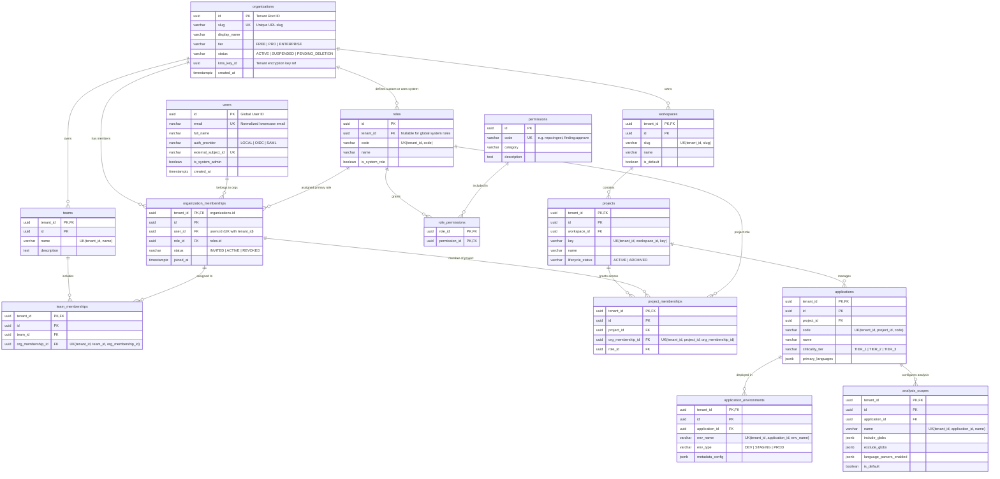
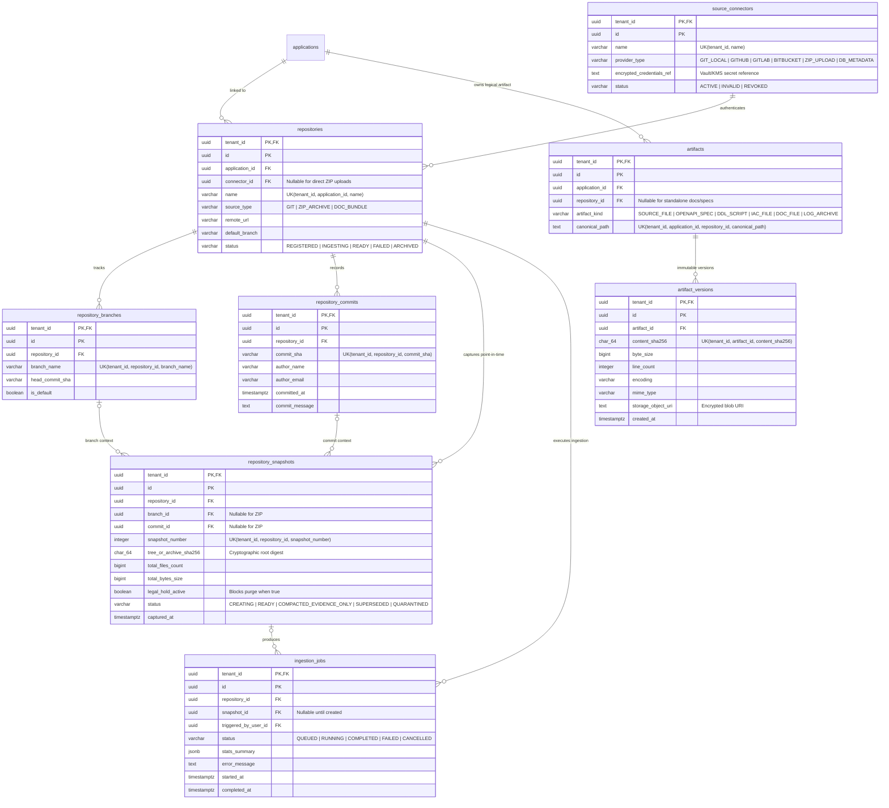
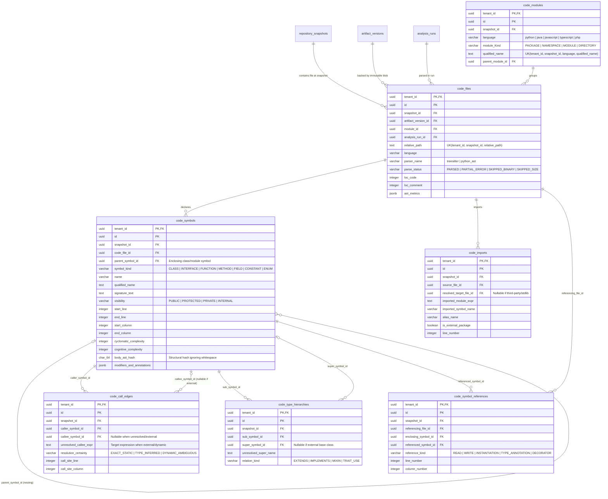
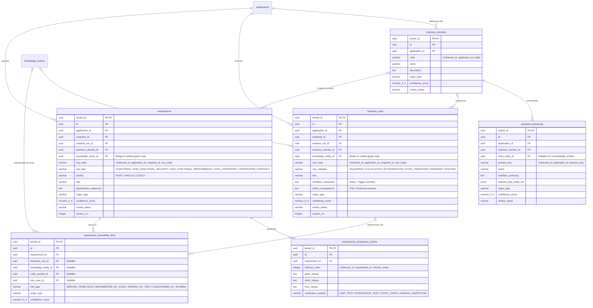
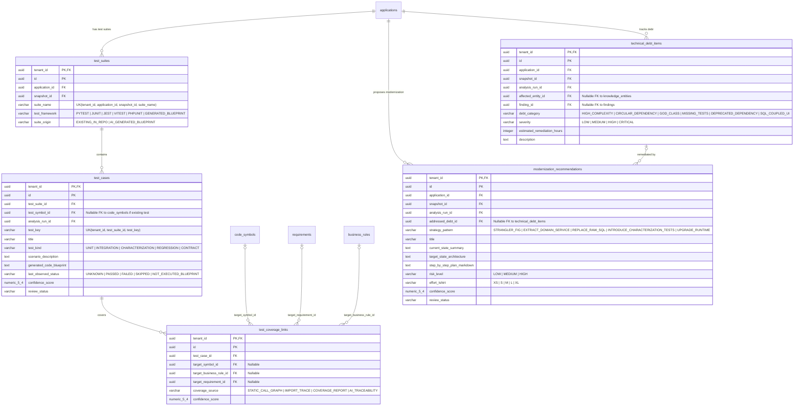
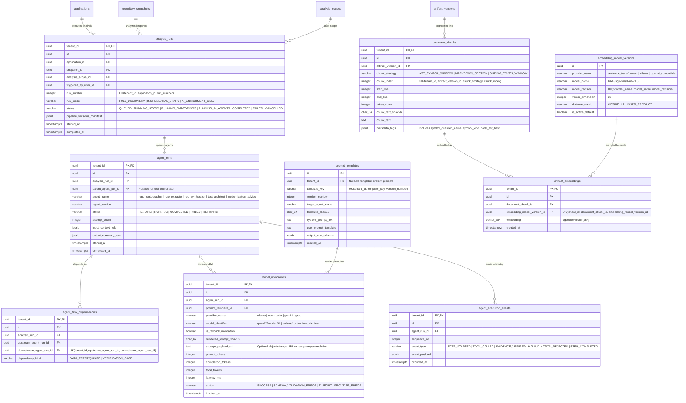

# LegacyIQ — Complete Entity-Relationship Diagrams (Design Phase D3)

**Document ID**: `D3-02`  
**Status**: Architecture Specification  

To maintain visual clarity and readability across all **71 tables**, the Entity-Relationship Diagrams (ERDs) are partitioned into **9 domain views** corresponding to Domains A through K.

> **Composite Tenant Foreign Key Convention**: Every tenant-scoped relationship enforces a composite foreign key `(tenant_id, <target>_id) REFERENCES <target_table>(tenant_id, id)` so that cross-tenant references are structurally rejected by PostgreSQL.

---

## 1. Domain A & B: Identity, Tenancy, Workspaces & Application Scope

Covers Organizations (Tenants), Users, Memberships, Teams, RBAC Roles/Permissions, Workspaces, Projects, Applications, Environments, and Analysis Scopes.

---

## 2. Domain C: Source Connectors & Immutable Ingestion

Covers Source Connectors, Repositories, Branches, Commits, Immutable Snapshots, Content-Addressed Artifacts, Artifact Versions, and Ingestion Jobs.

---

## 3. Domain D: Deterministic Code Intelligence (AST & Static Analysis)

Covers Snapshot-scoped Code Files, Modules/Packages, Symbols (Classes, Functions, Methods, Fields), Imports, Call Graph Edges, Type Hierarchies, and Symbol References.

---

## 4. Domain E: Technical, Data, API, Infrastructure & Runtime Intelligence

Covers extracted Database Schemas/Tables/Columns/Foreign Keys, API Services/Endpoints, Infrastructure Resources, Documentation Sections, and Runtime Observations.

```mermaid
erDiagram
    repository_snapshots ||--o{ db_schemas : "discovers DDL/ORM"
    db_schemas ||--o{ db_tables : "contains"
    db_tables ||--o{ db_columns : "has columns"
    db_tables ||--o{ db_foreign_keys : "source_table_id"
    db_tables ||--o{ db_foreign_keys : "target_table_id"

    repository_snapshots ||--o{ api_services : "discovers APIs"
    api_services ||--o{ api_endpoints : "exposes"
    code_symbols |o--o{ api_endpoints : "handler_symbol_id"

    repository_snapshots ||--o{ infra_resources : "discovers IaC"
    artifact_versions ||--o{ doc_sections : "parsed from doc"
    applications ||--o{ runtime_observations : "ingests telemetry"

    db_schemas {
        uuid tenant_id PK,FK
        uuid id PK
        uuid snapshot_id FK
        uuid source_artifact_version_id FK
        varchar db_engine "POSTGRESQL | MYSQL | ORACLE | MSSQL | SQLITE | MONGODB"
        varchar schema_name "UK(tenant_id, snapshot_id, schema_name)"
        varchar discovery_source "SQL_DDL | ORM_MODEL | MIGRATION_FILE | LIVE_CATALOG"
    }

    db_tables {
        uuid tenant_id PK,FK
        uuid id PK
        uuid db_schema_id FK
        uuid mapped_orm_symbol_id FK "Nullable FK to code_symbols"
        varchar table_name "UK(tenant_id, db_schema_id, table_name)"
        varchar table_kind "TABLE | VIEW | MATERIALIZED_VIEW"
        text comment_text
    }

    db_columns {
        uuid tenant_id PK,FK
        uuid id PK
        uuid db_table_id FK
        varchar column_name "UK(tenant_id, db_table_id, column_name)"
        integer ordinal_position
        varchar data_type
        boolean is_nullable
        boolean is_primary_key
        boolean is_pii_candidate
    }

    db_foreign_keys {
        uuid tenant_id PK,FK
        uuid id PK
        uuid source_table_id FK
        uuid target_table_id FK
        varchar constraint_name
        jsonb source_column_names
        jsonb target_column_names
        varchar relation_origin "EXPLICIT_DDL | ORM_RELATION | INFERRED_NAMING"
    }

    api_services {
        uuid tenant_id PK,FK
        uuid id PK
        uuid snapshot_id FK
        varchar service_name "UK(tenant_id, snapshot_id, service_name)"
        varchar protocol "REST | GRAPHQL | GRPC | SOAP | MESSAGE_CONSUMER"
        varchar base_path
    }

    api_endpoints {
        uuid tenant_id PK,FK
        uuid id PK
        uuid api_service_id FK
        uuid handler_symbol_id FK "Nullable FK to code_symbols"
        varchar http_method "GET | POST | PUT | DELETE | PATCH | RPC | SUB"
        text route_pattern "UK(tenant_id, api_service_id, http_method, route_pattern)"
        boolean auth_required_inferred
        jsonb request_schema_json
        jsonb response_schema_json
    }

    infra_resources {
        uuid tenant_id PK,FK
        uuid id PK
        uuid snapshot_id FK
        uuid source_artifact_version_id FK
        varchar iac_tool "DOCKERFILE | DOCKER_COMPOSE | KUBERNETES | TERRAFORM | CLOUDFORMATION"
        varchar resource_type
        varchar resource_name
        jsonb configuration_attributes
    }

    doc_sections {
        uuid tenant_id PK,FK
        uuid id PK
        uuid artifact_version_id FK
        uuid parent_section_id FK
        text heading_path
        integer heading_level
        integer start_line
        integer end_line
        text content_markdown
    }

    runtime_observations {
        uuid tenant_id PK,FK
        uuid id PK
        uuid application_id FK
        uuid environment_id FK
        uuid linked_endpoint_id FK "Nullable FK to api_endpoints"
        uuid linked_symbol_id FK "Nullable FK to code_symbols"
        varchar observation_kind "TRACE_SPAN | ERROR_RATE | LATENCY_P95 | SLOW_QUERY | LOG_PATTERN"
        jsonb metric_payload
        timestamptz observed_window_start
        timestamptz observed_window_end
    }
```

---

## 5. Domain F: Unified Knowledge Graph, Findings, Evidence & Review History

The core epistemological hub of LegacyIQ. Connects deterministic entities and AI-inferred domain abstractions via `knowledge_entities`, `knowledge_relationships`, `findings`, `evidence_anchors`, `finding_evidence_links`, `knowledge_conflicts`, and `review_history`.

```mermaid
erDiagram
    applications ||--o{ knowledge_entities : "scoped to app"
    repository_snapshots |o--o{ knowledge_entities : "introduced/observed in"
    analysis_runs ||--o{ knowledge_entities : "produced by run"
    code_symbols |o--o{ knowledge_entities : "bridges AST symbol"

    knowledge_entities ||--o{ knowledge_relationships : "source_entity_id"
    knowledge_entities ||--o{ knowledge_relationships : "target_entity_id"
    analysis_runs ||--o{ knowledge_relationships : "produced by run"

    applications ||--o{ findings : "surfaces finding"
    analysis_runs ||--o{ findings : "produced by run"
    knowledge_entities |o--o{ findings : "subject_entity_id"

    artifact_versions ||--o{ evidence_anchors : "pinned to immutable blob"
    findings ||--o{ finding_evidence_links : "backed by"
    knowledge_entities |o--o{ finding_evidence_links : "entity backed by"
    knowledge_relationships |o--o{ finding_evidence_links : "edge backed by"
    evidence_anchors ||--o{ finding_evidence_links : "provides anchor"

    knowledge_entities ||--o{ knowledge_conflicts : "conflicting subject"
    organizations ||--o{ review_history : "audits human review"

    knowledge_entities {
        uuid tenant_id PK,FK
        uuid id PK
        uuid application_id FK
        uuid snapshot_id FK
        uuid analysis_run_id FK
        uuid source_symbol_id FK "Nullable bridge to code_symbols"
        uuid source_db_table_id FK "Nullable bridge to db_tables"
        uuid source_api_endpoint_id FK "Nullable bridge to api_endpoints"
        varchar entity_type "COMPONENT | SERVICE | MODULE | SYMBOL | DB_TABLE | API_ENDPOINT | BUSINESS_CONCEPT | EXTERNAL_SYSTEM"
        text canonical_key "UK(tenant_id, application_id, snapshot_id, entity_type, canonical_key)"
        varchar title
        text summary_description
        varchar origin_type "DETERMINISTIC_PARSER | DETERMINISTIC_RULE | AI_INFERRED | HYBRID_AI_STATIC | HUMAN_AUTHORED"
        numeric_5_4 confidence_score "0.0000 to 1.0000"
        varchar review_status "DRAFT_AI | PENDING_REVIEW | APPROVED | MODIFIED_BY_HUMAN | REJECTED | SUPERSEDED"
        integer version_no
        jsonb attributes_json
    }

    knowledge_relationships {
        uuid tenant_id PK,FK
        uuid id PK
        uuid application_id FK
        uuid snapshot_id FK
        uuid analysis_run_id FK
        uuid source_entity_id FK
        uuid target_entity_id FK
        varchar relationship_type "CALLS | IMPORTS | READS_TABLE | WRITES_TABLE | EXPOSES_API | IMPLEMENTS_RULE | SATISFIES_REQ | TESTED_BY | DEPENDS_ON"
        varchar origin_type "DETERMINISTIC_PARSER | DETERMINISTIC_RULE | AI_INFERRED | HYBRID_AI_STATIC | HUMAN_AUTHORED"
        numeric_5_4 confidence_score
        numeric_8_4 edge_weight "Default 1.0000"
        varchar review_status "DRAFT_AI | PENDING_REVIEW | APPROVED | REJECTED"
        jsonb edge_metadata
    }

    findings {
        uuid tenant_id PK,FK
        uuid id PK
        uuid application_id FK
        uuid snapshot_id FK
        uuid analysis_run_id FK
        uuid subject_entity_id FK "Nullable FK to knowledge_entities"
        uuid producing_agent_run_id FK "Nullable FK to agent_runs"
        varchar finding_category "ARCHITECTURE | BUSINESS_RULE | REQUIREMENT | SECURITY_RISK | DEAD_CODE | PERFORMANCE | TECH_DEBT | MODERNIZATION"
        varchar severity "INFO | LOW | MEDIUM | HIGH | CRITICAL"
        varchar title
        text statement_markdown
        varchar origin_type "DETERMINISTIC_RULE | AI_INFERRED | HYBRID_AI_STATIC | HUMAN_AUTHORED"
        numeric_5_4 confidence_score
        varchar review_status "DRAFT_AI | PENDING_REVIEW | APPROVED | MODIFIED_BY_HUMAN | REJECTED | SUPERSEDED"
        uuid superseded_by_finding_id FK
        integer version_no
        timestamptz created_at
    }

    evidence_anchors {
        uuid tenant_id PK,FK
        uuid id PK
        uuid artifact_version_id FK
        uuid snapshot_id FK
        varchar locator_type "LINE_RANGE | BYTE_SPAN | AST_NODE_PATH | JSON_POINTER | DOC_HEADING"
        integer start_line
        integer end_line
        integer start_column
        integer end_column
        char_64 snippet_sha256 "Hash of exact cited excerpt"
        text excerpt_text "Bounded redacted snippet <= 2048 chars"
        timestamptz created_at
    }

    finding_evidence_links {
        uuid tenant_id PK,FK
        uuid id PK
        uuid evidence_anchor_id FK
        uuid finding_id FK "Nullable (at least one target non-null)"
        uuid knowledge_entity_id FK "Nullable"
        uuid knowledge_relationship_id FK "Nullable"
        uuid business_rule_id FK "Nullable"
        uuid requirement_id FK "Nullable"
        varchar evidence_role "PRIMARY_DEFINITION | CALL_SITE | CONFIG_BINDING | TEST_ASSERTION | DOC_CLAIM | CONTRADICTING_SOURCE"
        numeric_5_4 relevance_weight
        text rationale_note
    }

    knowledge_conflicts {
        uuid tenant_id PK,FK
        uuid id PK
        uuid application_id FK
        uuid snapshot_id FK
        varchar conflict_type "CODE_VS_DOC | AI_RUN_DIVERGENCE | STATIC_VS_RUNTIME | REQUIREMENT_CONTRADICTION"
        uuid primary_entity_or_finding_id
        uuid conflicting_entity_or_finding_id
        uuid primary_evidence_anchor_id FK
        uuid conflicting_evidence_anchor_id FK
        varchar status "OPEN | RESOLVED_KEEP_PRIMARY | RESOLVED_KEEP_CONFLICTING | RESOLVED_MERGED | DISMISSED"
        uuid resolved_by_user_id FK
        text resolution_notes
    }

    review_history {
        uuid tenant_id PK,FK
        uuid id PK
        varchar target_object_type "KNOWLEDGE_ENTITY | KNOWLEDGE_RELATIONSHIP | FINDING | BUSINESS_RULE | REQUIREMENT | MODERNIZATION_REC"
        uuid target_object_id
        uuid reviewer_user_id FK
        varchar previous_status
        varchar new_status
        jsonb previous_snapshot_json "Immutable before-image"
        jsonb updated_snapshot_json "Immutable after-image"
        text review_comment
        timestamptz reviewed_at
    }
```

---

## 6. Domain G: Business Logic & Requirements Intelligence

Covers Business Domains, Business Processes/Workflows, Extracted Business Rules, Functional & Non-Functional Requirements, Acceptance Criteria, and Traceability Links.

---

## 7. Domain H: Testing, Coverage & Modernization Intelligence

Covers Discovered & Generated Test Suites, Test Cases, Test Coverage Links, Technical Debt Items, and Modernization Recommendations.

---

## 8. Domain I & J: AI Orchestration, Prompt Lineage & Vector Retrieval

Covers Analysis Runs, Agent Runs, Task Dependencies, Versioned Prompt Templates, Model Invocations, Execution Events, Embedding Model Versions, Document Chunks, and `pgvector` Artifact Embeddings.

---

## 9. Domain K: Governance, Audit, Retention & SaaS Commercials

Covers Immutable Audit Logs, Governance Approval Requests, Data Retention Policies, Right-to-Erasure/Deletion Requests, Tenant Subscriptions, and Usage Quotas.

```mermaid
erDiagram
    organizations ||--o{ audit_logs : "records immutable audit trail"
    organizations ||--o{ approval_requests : "governs sensitive actions"
    organizations ||--o{ retention_policies : "configures retention"
    organizations ||--o{ deletion_requests : "tracks erasure workflows"
    organizations ||--|| tenant_subscriptions : "subscribed plan"
    organizations ||--o{ tenant_usage_quotas : "meters period usage"
    projects ||--o{ qa_conversations : "hosts Q&A sessions"
    qa_conversations ||--o{ qa_messages : "contains messages"
    projects ||--o{ intelligence_reports : "generates reports"
    intelligence_reports ||--o{ intelligence_report_versions : "versions (APPROVED immutable)"
    intelligence_report_versions ||--o{ report_exports : "exports PDF/DOCX/XLSX/JSON"

    audit_logs {
        uuid tenant_id PK,FK
        uuid id PK
        uuid actor_user_id FK "Nullable for system/worker events"
        varchar actor_type "USER | SYSTEM_WORKER | API_KEY | ADMIN_SUPPORT"
        varchar action_code "REPO_INGESTED | ANALYSIS_STARTED | FINDING_APPROVED | EXPORT_GENERATED | RLS_POLICY_VERIFIED"
        varchar target_resource_type
        uuid target_resource_id
        inet client_ip
        char_64 prev_audit_hash "Tamper-evident hash chain per tenant"
        char_64 entry_hash
        jsonb metadata_diff
        timestamptz occurred_at
    }

    approval_requests {
        uuid tenant_id PK,FK
        uuid id PK
        uuid project_id FK
        uuid requested_by_user_id FK
        uuid decided_by_user_id FK
        varchar request_type "BASELINE_REQUIREMENTS_SIGN_OFF | EXTERNAL_LLM_FALLBACK_OPT_IN | DATA_PURGE_APPROVAL"
        varchar status "PENDING | APPROVED | REJECTED | EXPIRED"
        jsonb request_payload
        text decision_reason
        timestamptz requested_at
        timestamptz decided_at
    }

    retention_policies {
        uuid tenant_id PK,FK
        uuid id PK
        varchar artifact_category "RAW_SOURCE_BLOBS | SNAPSHOT_AST | AI_INVOCATION_LOGS | AUDIT_LOGS"
        integer retain_days
        integer max_snapshots_per_repo
        boolean auto_purge_enabled
        timestamptz updated_at
    }

    deletion_requests {
        uuid tenant_id PK,FK
        uuid id PK
        uuid requested_by_user_id FK
        varchar deletion_scope "SINGLE_SNAPSHOT | REPOSITORY | PROJECT | FULL_TENANT_OFFBOARDING"
        uuid target_scope_id
        varchar status "REQUESTED | APPROVED | IN_PROGRESS | CRYPTO_SHREDDED | COMPLETED | FAILED"
        char_64 completion_certificate_sha256
        timestamptz requested_at
        timestamptz completed_at
    }

    tenant_subscriptions {
        uuid tenant_id PK,FK
        uuid id PK
        varchar plan_code "LOCAL_COMMUNITY | CONSULTING_TEAM | ENTERPRISE_SAAS"
        varchar billing_status "ACTIVE | TRIALING | PAST_DUE | CANCELLED"
        integer max_repositories_allowed
        bigint max_loc_allowed
        boolean allow_cloud_llm_providers
        timestamptz current_period_start
        timestamptz current_period_end
    }

    tenant_usage_quotas {
        uuid tenant_id PK,FK
        uuid id PK
        date billing_month "UK(tenant_id, billing_month)"
        integer repositories_count
        bigint analyzed_loc_count
        bigint vector_chunks_stored
        bigint local_llm_tokens_used
        bigint cloud_llm_tokens_used
        bigint object_storage_bytes_used
        timestamptz updated_at
    }

    qa_conversations {
        uuid tenant_id PK,FK
        uuid id PK
        uuid project_id FK
        uuid application_id FK
        uuid snapshot_id FK
        uuid created_by_user_id FK
        varchar title
        varchar conversation_status "ACTIVE | ARCHIVED"
        timestamptz created_at
        timestamptz updated_at
    }

    qa_messages {
        uuid tenant_id PK,FK
        uuid id PK
        uuid conversation_id FK
        uuid snapshot_id FK
        integer sequence_no "UK(tenant_id, conversation_id, sequence_no)"
        varchar role "USER | ASSISTANT"
        varchar question_intent
        text content_markdown
        jsonb direct_facts_json
        jsonb inferred_explanations_json
        jsonb citations_json
        boolean insufficient_evidence
        numeric_5_4 confidence_score
        timestamptz created_at
    }

    intelligence_reports {
        uuid tenant_id PK,FK
        uuid id PK
        uuid project_id FK
        uuid application_id FK
        uuid snapshot_id FK
        varchar report_type "11 canonical report types"
        varchar title
        integer current_version_no
        varchar lifecycle_status "DRAFT | GENERATED | SUBMITTED_FOR_REVIEW | APPROVED | REJECTED | ARCHIVED"
        timestamptz created_at
        timestamptz updated_at
    }

    intelligence_report_versions {
        uuid tenant_id PK,FK
        uuid id PK
        uuid report_id FK
        uuid snapshot_id FK
        integer version_no "UK(tenant_id, report_id, version_no)"
        varchar lifecycle_status
        boolean is_immutable "true once APPROVED"
        text executive_summary_markdown
        jsonb sections_json
        jsonb evidence_refs_json
        char_64 content_sha256
        timestamptz created_at
    }

    report_exports {
        uuid tenant_id PK,FK
        uuid id PK
        uuid project_id FK
        uuid report_id FK
        uuid report_version_id FK
        varchar export_format "PDF | DOCX | XLSX | JSON"
        varchar file_name
        bigint file_size_bytes
        char_64 content_sha256
        text storage_object_uri
        integer download_count
        timestamptz created_at
    }
```

