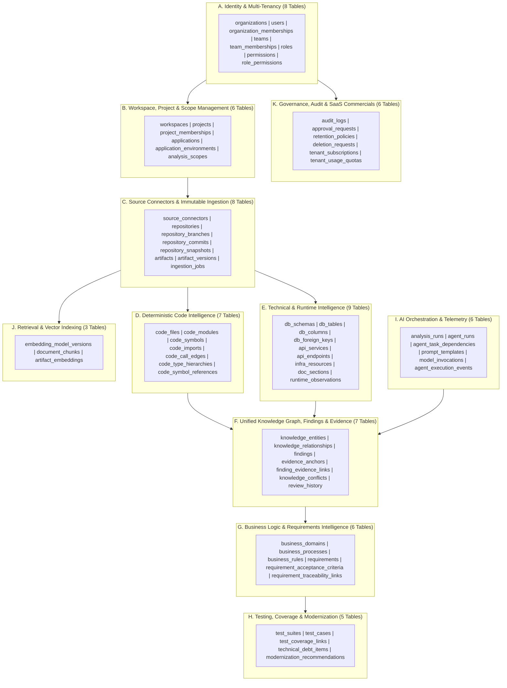

# LegacyIQ — Database & Unified Knowledge Architecture (Design Phase D3)

**Document ID**: `D3-01`  
**Status**: Architecture Specification (Pending Product-Owner Review)  
**Target Engine**: PostgreSQL 17 (`pgvector/pgvector:pg17` with `vector` v0.8.7)  

---

## 1. Executive Architectural Summary

LegacyIQ is an enterprise multi-tenant SaaS platform that ingests heterogeneous legacy system artifacts—source code across polyglot language families, Git repositories, ZIP archives, database schemas, API specifications, infrastructure-as-code (IaC), technical documentation, and optional runtime telemetry—and reconstructs **evidence-backed** architectural, business logic, requirement, testing, and modernization intelligence.

This document establishes the foundational database architecture governing all **71 canonical tables across 11 bounded domains (Domains A–K)**. Every design choice enforces the central product invariant:

> **The Evidence Invariant**: No extracted code symbol, dependency edge, architectural component, business rule, requirement, test case, or modernization recommendation may exist as an authoritative platform finding without verifiable, immutable provenance linking it to exact source artifact version coordinates and/or deterministic analyzer or versioned AI execution runs.

---

## 2. Finalized Architectural Decisions & How the Schema Implements Them

| # | Architectural Decision | Database & Storage Implementation Strategy |
| :--- | :--- | :--- |
| **1** | **Shared Multi-Tenant SaaS Infrastructure** | Single PostgreSQL 17 cluster with shared physical tables. Every tenant-owned row carries a mandatory `tenant_id UUID NOT NULL` column (`organizations.id`) and participates in composite primary/unique keys `(tenant_id, id)` so cross-tenant foreign key references are structurally impossible at the DDL constraint level. |
| **2** | **PostgreSQL 17 as System of Record** | All identity, ingestion metadata, deterministic AST facts, unified knowledge graph nodes/edges, requirements, findings, evidence spans, human reviews, and audit trails are stored ACID-compliantly in PostgreSQL 17. Redis is strictly ephemeral (job queues, pub/sub, short-lived rate-limit counters) and never holds authoritative state. |
| **3** | **pgvector for Semantic Embeddings** | Vector embeddings are stored in `artifact_embeddings` using PostgreSQL `vector(384)` (defaulting to local `BAAI/bge-small-en-v1.5`) with support for multi-model dimension profiles via `embedding_model_versions` and HNSW (`vector_cosine_ops`) partial/partitioned indexing. |
| **4** | **Relational Knowledge Graph Initially** | Rather than introducing a separate operational graph database (e.g., Neo4j) that would split transactions and complicate multi-tenant RLS, LegacyIQ implements a typed relational property graph via `knowledge_entities` (nodes) and `knowledge_relationships` (directed, typed, weighted, evidence-backed edges). |
| **5** | **NetworkX for In-Memory Graph Projections** | Complex graph algorithms (strongly connected components, Dominator trees, PageRank centrality, cycle detection, blast-radius traversal, and topological layering) are executed by projecting tenant- and snapshot-scoped slices of `knowledge_entities` and `knowledge_relationships` into Python NetworkX `MultiDiGraph` structures in worker memory, then persisting computed metrics back to PostgreSQL. |
| **6** | **Encrypted Tenant-Isolated Object Storage** | Raw repository blobs, ZIP uploads, large AST dumps, and raw LLM payloads are stored outside PostgreSQL in content-addressed, tenant-prefixed encrypted object storage (`s3://<bucket>/<tenant_id>/blobs/<sha256>`). PostgreSQL stores cryptographic hashes (`sha256_hex`), byte lengths, MIME metadata, and encryption key references (`kms_key_ref`) in `artifacts` and `artifact_versions`. |
| **7** | **Immutable Repository Snapshots** | Every repository ingestion captures a point-in-time `repository_snapshots` record tied to a commit SHA or upload digest. Source artifacts (`artifact_versions`) are content-addressed and append-only; re-analyzing a repository creates a new snapshot or new analysis run without mutating prior snapshots. |
| **8** | **Versioned Analysis Runs** | Every static parser pass and AI extraction pipeline executes within an explicit `analysis_runs` context tied to a `snapshot_id` and `analysis_scope_id`. Deterministic facts and AI interpretations are stamped with `analysis_run_id`, allowing side-by-side comparison across runs and safe rollback. |
| **9** | **Hybrid Human Review** | AI-synthesized entities, business rules, requirements, and findings carry machine confidence scores (`0.0000`–`1.0000`) and lifecycle review states (`DRAFT_AI`, `PENDING_REVIEW`, `APPROVED`, `MODIFIED_BY_HUMAN`, `REJECTED`, `SUPERSEDED`). Human edits never overwrite raw AI outputs; revisions and rationale are recorded in `review_history`. |
| **10** | **Centralized Agent Orchestration** | Multi-step AI workflows are tracked in `agent_runs`, `agent_task_dependencies`, `model_invocations`, and `agent_execution_events`, capturing prompt template versions, input context hashes, token consumption, latency, and fallback routing. |
| **11** | **Explicit Tenant Ownership & PostgreSQL RLS** | Every tenant-owned table enables `ROW LEVEL SECURITY` and `FORCE ROW LEVEL SECURITY`, bound to session variable `app.current_tenant_id` set via transaction-scoped `SET LOCAL` inside SQLAlchemy session checkout hooks. |
| **12** | **Local-First AI Development** | Provider catalogs (`embedding_model_versions`, `model_invocations`) natively model local zero-cost runtimes (`ollama/qwen2.5-coder:3b`, `sentence_transformers/BAAI/bge-small-en-v1.5`) alongside optional cloud fallbacks (`openrouter`, `gemini`, `groq`). |

---

## 3. Domain Decomposition (Domains A–K)

The LegacyIQ schema is organized into **11 logical domains** comprising **71 tables**:

*(Note: Exact table inventory per domain is cataloged in [data-dictionary.md](file:///C:/LegacyIQ/docs/database/data-dictionary.md) and [tenant-ownership-matrix.md](file:///C:/LegacyIQ/docs/database/tenant-ownership-matrix.md).)*

---

## 4. Separation of Deterministic Facts vs. AI Interpretations

A core architectural failure mode in AI code-intelligence tools is conflating deterministic parser output with probabilistic LLM inferences. LegacyIQ enforces a strict **Two-Stratum Epistemological Model**:

### Stratum 1: Deterministic Facts (Immutable Per Snapshot & Parser Version)
- **Tables**: Domain C (`repository_snapshots`, `artifacts`, `artifact_versions`), Domain D (`code_files`, `code_modules`, `code_symbols`, `code_imports`, `code_call_edges`, `code_type_hierarchies`, `code_symbol_references`), and deterministic parts of Domain E (`db_schemas`, `db_tables`, `db_columns`, `db_foreign_keys`, `api_services`, `api_endpoints`, `infra_resources`, `doc_sections`).
- **Characteristics**:
  - Produced exclusively by deterministic parsers (Tree-sitter, Python `ast`, SQL DDL parsers, OpenAPI/Swagger parsers, Terraform/Dockerfile parsers).
  - `origin_type` is always `'DETERMINISTIC_PARSER'`.
  - Confidence is structurally `1.0000` (or explicit static resolution certainty: `'EXACT_STATIC'`, `'TYPE_INFERRED'`, `'DYNAMIC_AMBIGUOUS'`).
  - Never modified by AI agents or human reviewers (unless a parser bug is fixed in a subsequent `analysis_run_id`).

### Stratum 2: Synthesized Knowledge & AI Interpretations (Versioned, Confidence-Scored, Reviewable)
- **Tables**: Domain F (`knowledge_entities` where `origin_type != 'DETERMINISTIC_PARSER'`, `knowledge_relationships`, `findings`, `knowledge_conflicts`, `review_history`), Domain G (`business_processes`, `business_rules`, `requirements`, `requirement_acceptance_criteria`), and Domain H (`test_cases` where generated, `technical_debt_items`, `modernization_recommendations`).
- **Characteristics**:
  - Every row records:
    - `origin_type`: `'DETERMINISTIC_RULE' | 'AI_INFERRED' | 'HYBRID_AI_STATIC' | 'HUMAN_AUTHORED'`
    - `analysis_run_id`: Foreign key to the exact `analysis_runs` execution.
    - `producing_agent_run_id` / `producing_invocation_id`: Foreign key to the exact LLM invocation and prompt template version.
    - `confidence_score`: `NUMERIC(5,4)` (`0.0000` to `1.0000`).
    - `review_status`: `'DRAFT_AI' | 'PENDING_REVIEW' | 'APPROVED' | 'MODIFIED_BY_HUMAN' | 'REJECTED' | 'SUPERSEDED'`.
  - Must link to at least one `evidence_anchors` record (enforced by application service transaction and audited via completeness checks).

---

## 5. Transaction Boundaries for Ingestion and Analysis

To maintain database responsiveness, prevent long-lived row locks, and ensure clean failure recovery across multi-gigabyte repositories, LegacyIQ defines **five strict transaction boundary patterns**:

### Boundary T1: Snapshot & Manifest Registration (Short ACID Transaction)
1. Worker streams repository archive/Git tree to encrypted object storage and computes SHA-256 content hashes in memory/disk scratch.
2. Within a single database transaction (`< 500 ms`):
   - Insert `repository_snapshots` (`status = 'INGESTING'`).
   - Bulk-upsert content-addressed `artifacts` and `artifact_versions` using `INSERT ... ON CONFLICT (tenant_id, sha256_hex) DO NOTHING`.
   - Commit and transition `repository_snapshots.status = 'READY_FOR_ANALYSIS'`.

### Boundary T2: File-Batch Static AST Extraction (Chunked Micro-Transactions)
1. Static analysis (`analysis_runs`) never holds an open transaction across an entire repository.
2. Files are processed in deterministic batches (e.g., 100–250 files per batch).
3. For each batch, a short transaction (`< 1 s`) uses PostgreSQL `COPY` or batched multi-row `INSERT` to write `code_files`, `code_symbols`, `code_imports`, and `evidence_anchors`, then commits immediately.
4. Cross-file symbol resolution (`code_call_edges`, `code_symbol_references`) runs as a second pass after all file-local symbol tables are committed.

### Boundary T3: Vector Chunking & Embedding Persistence (Idempotent Batch Transactions)
1. `document_chunks` are generated deterministically from `artifact_versions` (keyed by `(tenant_id, artifact_version_id, chunk_strategy_version, chunk_index)`).
2. Local Sentence Transformers (`BAAI/bge-small-en-v1.5`) or external embedding providers compute vectors **outside** any database transaction.
3. Computed embeddings are written in batches of 500 vectors per transaction into `artifact_embeddings`.

### Boundary T4: AI Agent Execution & Knowledge Synthesis (Zero-DB-Connection During Inference)
1. **Critical Rule**: Workers **must never hold an open PostgreSQL transaction or checked-out connection pool slot while waiting on Ollama or cloud LLM HTTP inference**.
2. Pattern:
   - **Step A ( Short Tx)**: Checkout connection, set RLS context, read context chunks/graph slice, insert `agent_runs` (`status = 'RUNNING'`), commit, and **return connection to pool**.
   - **Step B (No DB Connection)**: Execute LLM inference (`qwen2.5-coder:3b` or fallback), validate structured JSON output against Pydantic schema, verify cited line numbers against source text.
   - **Step C (Short Atomic Tx)**: Checkout connection, set RLS context, write `model_invocations`, `knowledge_entities`, `knowledge_relationships`, `findings`, `evidence_anchors`, and `finding_evidence_links`, update `agent_runs.status = 'COMPLETED'`, and commit atomically.

### Boundary T5: Human Review & Conflict Resolution (Optimistic Concurrency Transaction)
1. Human review operations (`APPROVE`, `MODIFY`, `REJECT`, `RESOLVE_CONFLICT`) execute in a single serializable/optimistically-locked transaction checking `version_no` on the target entity/finding.
2. Inserts an immutable row into `review_history` and `audit_logs` within the same transaction before committing.

---

## 6. Support for Very Large Repositories (Scale Architecture)

Enterprise monorepos can exceed 50,000 files, 2,000,000 code symbols, and 10,000,000 call/reference edges per snapshot. The schema prevents storage bloat and query degradation via four mechanisms:

1. **Content-Addressed Artifact Deduplication**:
   - Unchanged files across 50 snapshots of the same repository share a single `artifact_versions` row (`(tenant_id, artifact_id, content_sha256)`).
   - Document chunks and vector embeddings (`document_chunks`, `artifact_embeddings`) are keyed to `artifact_version_id` rather than `snapshot_id`. If 98% of files are unchanged between commits `A` and `B`, **zero duplicate chunks or vector embeddings are stored or recomputed**.
2. **Snapshot Manifest Mapping (`snapshot_artifact_map` via `code_files`)**:
   - `code_files` binds `(tenant_id, snapshot_id, file_path)` to `artifact_version_id`. AST symbols that depend only on file syntax can optionally be reused or copy-on-write linked via `artifact_version_id`.
3. **Declarative Table Partitioning Ready**:
   - High-cardinality tables (`code_symbols`, `code_call_edges`, `code_symbol_references`, `knowledge_relationships`, `artifact_embeddings`, `agent_execution_events`, `audit_logs`) are designed with `tenant_id` in their primary key, allowing transparent hash partitioning by `tenant_id` (e.g., 16 or 64 partitions) or range partitioning by `created_at` (for `audit_logs` and `agent_execution_events`) without changing application queries.
4. **Externalized Large Payloads**:
   - Source file contents, full AST syntax trees, and raw LLM completion bodies exceeding inline preview thresholds are stored in encrypted object storage; PostgreSQL stores only normalized structural rows and compact `evidence_anchors` snippets (`<= 2 KB`).

---

## 7. Normalization vs. Controlled Denormalization Trade-Offs

| Design Area | Normalization Choice | Controlled Denormalization & Rationale |
| :--- | :--- | :--- |
| **`tenant_id` on Every Child Table** | Strictly redundant in 3NF if parent already has `tenant_id`. | **Mandatory Denormalization**: Required on all 60 tenant-owned tables so PostgreSQL RLS policies can evaluate `tenant_id = current_setting('app.current_tenant_id')::uuid` via direct index lookup without executing multi-table joins on every row check. |
| **Code Entities vs. Unified `knowledge_entities`** | Domain D stores language-precise AST structures (`code_symbols`), while Domain F stores unified graph nodes (`knowledge_entities`). | **Bridge Pattern (Avoiding Dual-Write Drift)**: `code_symbols` holds deterministic AST attributes (line numbers, cyclomatic complexity, signature tokens). `knowledge_entities` references `source_symbol_id` (nullable FK to `code_symbols`) when representing a code symbol in the cross-domain graph, rather than duplicating AST columns. |
| **`evidence_anchors.excerpt_text`** | Could be slice-computed dynamically from object storage on every UI view. | **Controlled Caching**: Storing a bounded, redacted preview snippet (`<= 2048 chars`) alongside `content_sha256` and byte/line offsets allows instant rendering of evidence citations in reports while cryptographic hash verification detects any drift. |

---

## 8. Cross-Reference to Companion D3 Specifications

1. [complete-erd.md](file:///C:/LegacyIQ/docs/database/complete-erd.md) — Domain-by-domain Mermaid ER diagrams with PKs, composite FKs, cardinalities, and uniqueness constraints.
2. [data-dictionary.md](file:///C:/LegacyIQ/docs/database/data-dictionary.md) — Exhaustive column-level specification for all 64 tables across Domains A–K.
3. [tenant-ownership-matrix.md](file:///C:/LegacyIQ/docs/database/tenant-ownership-matrix.md) — Tenant isolation classification, composite FK rules, and lifecycle policies for every table.
4. [knowledge-model.md](file:///C:/LegacyIQ/docs/database/knowledge-model.md) — End-to-end conceptual and relational walkthrough from `Repository` to `Evidence`.
5. [evidence-and-provenance-model.md](file:///C:/LegacyIQ/docs/database/evidence-and-provenance-model.md) — Cryptographic anchoring, provenance chains, confidence scoring, and conflict resolution.
6. [graph-relationship-catalogue.md](file:///C:/LegacyIQ/docs/database/graph-relationship-catalogue.md) — Canonical node/edge taxonomy, relational storage, recursive CTEs, and NetworkX projection protocols.
7. [indexing-and-query-strategy.md](file:///C:/LegacyIQ/docs/database/indexing-and-query-strategy.md) — B-tree, GIN, GiST, and `pgvector` HNSW index specifications and query plans.
8. [versioning-and-retention.md](file:///C:/LegacyIQ/docs/database/versioning-and-retention.md) — Immutability guarantees, snapshot diffing, GDPR/tenant offboarding, and crypto-shredding.
9. [database-security-and-rls-design.md](file:///C:/LegacyIQ/docs/database/database-security-and-rls-design.md) — PostgreSQL RLS DDL policies, connection pooling context lifecycle, encryption, and architecture review.

