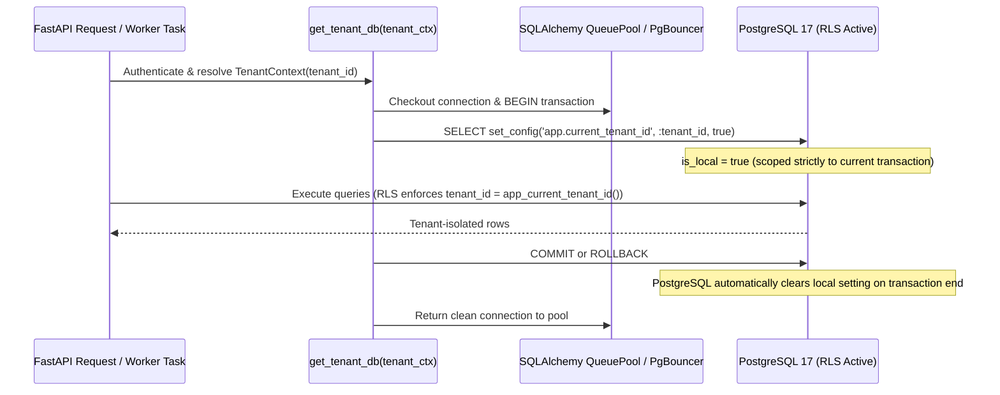

# LegacyIQ — Database Security, PostgreSQL RLS & Architecture Review (Design Phase D3)

**Document ID**: `D3-10`  
**Status**: Architecture Specification & Formal D3 Review  

---

## 1. PostgreSQL Row-Level Security (RLS) Design

### 1.1 Database Role Hierarchy (Principle of Least Privilege)
LegacyIQ separates database roles so that the runtime FastAPI application and background workers **never connect as a PostgreSQL superuser or table owner** (which would bypass RLS by default):

| PostgreSQL Role | Attributes | Purpose |
| :--- | :--- | :--- |
| `legacyiq_migrator` | `NOLOGIN` (or restricted CI/CD login), owns schema & tables | Used exclusively by Alembic migrations to execute DDL. |
| `legacyiq_app` | `LOGIN NOBYPASSRLS NOSUPERUSER NOCREATEDB NOCREATEROLE` | Runtime role used by FastAPI web workers and background analysis workers. Subject to mandatory RLS on all tables. |
| `legacyiq_readonly_audit` | `LOGIN NOBYPASSRLS NOSUPERUSER` | Restricted read-only role for compliance verification. |

### 1.2 Session Context Helper Functions
```sql
-- Returns the current transaction's tenant UUID, or NULL if unset
CREATE OR REPLACE FUNCTION app_current_tenant_id()
RETURNS uuid
LANGUAGE sql
STABLE
PARALLEL SAFE
AS $$
    SELECT NULLIF(current_setting('app.current_tenant_id', true), '')::uuid;
$$;
```

### 1.3 Canonical RLS Policy Templates

#### Pattern 1: Strictly Tenant-Owned Tables (`TENANT_DIRECT` — 58 Tables)
```sql
ALTER TABLE knowledge_entities ENABLE ROW LEVEL SECURITY;
ALTER TABLE knowledge_entities FORCE ROW LEVEL SECURITY;

CREATE POLICY tenant_isolation_policy ON knowledge_entities
    AS PERMISSIVE
    FOR ALL
    TO legacyiq_app
    USING (tenant_id = app_current_tenant_id())
    WITH CHECK (tenant_id = app_current_tenant_id());
```
*Fail-Closed Guarantee*: If `app.current_tenant_id` is not set (`NULL`), `tenant_id = NULL` evaluates to `UNKNOWN` (`false`), returning **zero rows** on `SELECT` and rejecting `INSERT`/`UPDATE`/`DELETE`.

#### Pattern 2: Hybrid System + Tenant Catalog Tables (`roles`, `prompt_templates`)
```sql
ALTER TABLE prompt_templates ENABLE ROW LEVEL SECURITY;
ALTER TABLE prompt_templates FORCE ROW LEVEL SECURITY;

-- Tenants can read global defaults (tenant_id IS NULL) and their own custom templates
CREATE POLICY prompt_templates_select_policy ON prompt_templates
    FOR SELECT
    TO legacyiq_app
    USING (tenant_id IS NULL OR tenant_id = app_current_tenant_id());

-- Tenants can only insert/update/delete their own custom templates
CREATE POLICY prompt_templates_write_policy ON prompt_templates
    FOR ALL
    TO legacyiq_app
    USING (tenant_id = app_current_tenant_id())
    WITH CHECK (tenant_id = app_current_tenant_id());
```

#### Pattern 3: Append-Only Compliance Ledger (`audit_logs`, `review_history`)
```sql
ALTER TABLE audit_logs ENABLE ROW LEVEL SECURITY;
ALTER TABLE audit_logs FORCE ROW LEVEL SECURITY;

CREATE POLICY audit_logs_select_insert_policy ON audit_logs
    FOR SELECT
    TO legacyiq_app
    USING (tenant_id = app_current_tenant_id());

CREATE POLICY audit_logs_insert_policy ON audit_logs
    FOR INSERT
    TO legacyiq_app
    WITH CHECK (tenant_id = app_current_tenant_id());

-- Trigger blocking any UPDATE or DELETE on audit_logs and review_history
CREATE OR REPLACE FUNCTION prevent_immutable_ledger_mutation()
RETURNS trigger LANGUAGE plpgsql AS $$
BEGIN
    RAISE EXCEPTION 'Security Violation: Table % is append-only and cannot be modified or deleted.', TG_TABLE_NAME;
END;
$$;
```

---

## 2. Connection Pooling & Tenant Context Lifecycle

A classic multi-tenant vulnerability occurs when connection pooling (SQLAlchemy `QueuePool` or PgBouncer) reuses a database connection across two HTTP requests and leaks a session-level `SET app.current_tenant_id` from Request A to Request B.

LegacyIQ eliminates this risk via **Transaction-Scoped `SET LOCAL`**:



### Mandatory Pooling Rules
1. **Always Use `set_config(..., is_local => true)` / `SET LOCAL`**: Never use session-level `SET app.current_tenant_id`.
2. **PgBouncer Compatibility**: Because `SET LOCAL` is transaction-scoped, the architecture is 100% compatible with `pool_mode = transaction` in PgBouncer.
3. **Pool Reset Guard**: On SQLAlchemy connection checkin (`@event.listens_for(engine, "checkin")`), the pool executes `RESET ALL` / rolls back any uncommitted state.

---

## 3. Formal Architecture Review (Mandatory D3 Evaluation)

### 3.1 Alternative Schema Designs Evaluated

| Design Question | Chosen Design (D3 Baseline) | Alternative Considered | Why Alternative Was Rejected / Deferred |
| :--- | :--- | :--- | :--- |
| **Multi-Tenancy Physical Layout** | Shared schema + `tenant_id` in every PK/FK + PostgreSQL RLS. | Schema-per-tenant (`tenant_123.code_symbols`). | Schema-per-tenant breaks down past ~500 tenants due to PostgreSQL catalog bloat (`pg_class` / `pg_attribute` lock contention) and makes running Alembic migrations across 1,000 schemas operationally fragile. |
| **Knowledge Graph Storage** | Relational tables (`knowledge_entities`, `knowledge_relationships`) + in-memory NetworkX projections. | Dedicated Neo4j or Apache AGE graph database. | Separate Neo4j splits ACID transactions between findings/evidence and graph nodes, doubles infrastructure cost, and lacks native PostgreSQL RLS. |
| **AST vs. Knowledge Entity Storage** | Separate `code_symbols` (Domain D) bridged via `source_symbol_id` to `knowledge_entities` (Domain F). | Single polymorphic mega-table for all AST symbols, DB tables, and business concepts. | A single polymorphic table either suffers from 40+ nullable columns or forces AST attributes into untyped `JSONB`, losing strict column types and index efficiency on `code_symbols`. |
| **Vector Embedding Granularity** | Keyed to immutable `artifact_version_id` via `document_chunks`. | Keyed directly to `snapshot_id`. | Keying embeddings to `snapshot_id` duplicates 95%+ of vectors on every new Git commit snapshot, causing 10x–50x storage and compute waste. |

---

### 3.2 Potential Data Duplication & Normalization Issues Identified

1. **`code_symbols` vs. `knowledge_entities` Title/Name Sync**:
   - *Risk*: When a `code_symbol` is promoted into `knowledge_entities` (`entity_type = 'SYMBOL'`), storing `title` and `canonical_key` on `knowledge_entities` duplicates `code_symbols.name` and `qualified_name`.
   - *Mitigation*: `code_symbols` is immutable for a snapshot; `knowledge_entities` rows with `origin_type = 'DETERMINISTIC_PARSER'` are generated deterministically from `code_symbols` in the same pipeline step and never mutated independently.
2. **`code_call_edges` (Domain D) vs. `knowledge_relationships` (`CALLS`, Domain F)**:
   - *Risk*: Storing every low-level private helper call in both `code_call_edges` and `knowledge_relationships` would double edge storage on multi-million-line monorepos.
   - *Mitigation*: `code_call_edges` stores the **complete raw AST call graph** (including fine-grained intra-class helper calls), whereas `knowledge_relationships` stores **architecturally significant and cross-domain edges** (module/component/service calls, entrypoints, DB reads/writes, rule implementations, requirement links).
3. **`evidence_anchors.excerpt_text` Storage Footprint**:
   - *Risk*: Thousands of findings citing the same large class could duplicate source excerpts.
   - *Mitigation*: `evidence_anchors` is content-addressed and deduplicated by `UNIQUE (tenant_id, artifact_version_id, locator_type, start_line, end_line, start_column, end_column, snippet_sha256)`. Multiple findings citing the same code block link to the **single shared `evidence_anchors` row** via `finding_evidence_links`.

---

### 3.3 Performance Considerations

1. **HNSW Index Build Memory (`maintenance_work_mem`)**:
   - Building HNSW indexes on `artifact_embeddings` (`vector(384)`) is memory-intensive. Worker sessions running bulk vector indexing should set `SET LOCAL maintenance_work_mem = '512MB'`.
2. **High-Volume Bulk Ingestion (`COPY` vs. ORM `add_all`)**:
   - Inserting 500,000 `code_symbols` and `code_call_edges` via ORM row-by-row `INSERT` is slow. Ingestion workers should use PostgreSQL binary `COPY` (`psycopg` `cursor.copy()`) into staging/target tables within chunked batches.
3. **Partitioning Trigger Thresholds**:
   - When `code_symbols`, `code_call_edges`, `knowledge_relationships`, or `artifact_embeddings` exceed `50,000,000` rows across the cluster, declarative hash partitioning by `tenant_id` (`PARTITION BY HASH (tenant_id)`) can be enabled seamlessly because `tenant_id` is already the leading column of every primary and unique key.

---

### 3.4 Security Risks & Mitigations

| Security Risk | Severity | Architectural Mitigation in D3 Schema |
| :--- | :---: | :--- |
| **Cross-Tenant Foreign Key Injection** | Critical | Prevented structurally at DDL level: every tenant FK is composite `(tenant_id, <fk>_id) REFERENCES <parent>(tenant_id, id)`. |
| **Missing `SET LOCAL` in a New Endpoint** | High | Fail-closed RLS policy (`tenant_id = app_current_tenant_id()`) returns 0 rows / raises check error when `app.current_tenant_id` is unset. |
| **Hardcoded Secrets Inside Customer Source Code Leaking into `evidence_anchors` or Cloud LLMs** | High | Pre-ingestion entropy/regex secret scanner masks credentials (`***REDACTED_SECRET***`) before populating `evidence_anchors.excerpt_text` or `document_chunks.chunk_text`. Cloud LLMs are hard-blocked unless `tenant_subscriptions.allow_cloud_llm_providers = true`. |
| **Malicious Archive Upload (Zip-Slip / Zip-Bomb / Symlink Escape)** | High | Enforced in ingestion worker before any `artifact_versions` creation; `repository_snapshots.total_bytes_size` and `analysis_scopes.max_file_size_bytes` enforce hard quotas. |

---

### 3.5 Migration Risks (Future Phased Rollout)

1. **Enabling RLS Without `legacyiq_app` Role Separation**:
   - If the application connects as `legacyiq_admin` (the table owner in M0 local dev), PostgreSQL bypasses RLS for table owners unless `FORCE ROW LEVEL SECURITY` is enabled **and** `NOBYPASSRLS` is set on the role. Future migrations must provision the non-owner runtime role or apply `FORCE ROW LEVEL SECURITY`.
2. **Multi-Dimension Embedding Models**:
   - `artifact_embeddings.embedding` is typed as `vector(384)` for `BAAI/bge-small-en-v1.5`. If a tenant later switches to a `768`- or `1536`-dimension cloud embedding model, `pgvector` HNSW indexes require fixed dimensions per column/index. Supporting multiple dimensions simultaneously requires either separate partial expression indexes `(embedding::vector(768))` on an untyped `vector` column or dimension-specific child partitions.

---

### 3.6 Provisional Product-Owner Decisions (`Q1`–`Q5`)

The 5 architectural open questions identified during D3 design have been assigned **PROVISIONAL** resolutions (documented in full in [d3-decisions-register.md](file:///C:/LegacyIQ/docs/database/d3-decisions-register.md)) pending final Architecture Review sign-off:

1. **Q1 (`PROVISIONAL`) — Vector Dimension Strategy (`artifact_embeddings`)**:
   - Use fixed `vector(384)` initially (paired with `embedding_model_versions` metadata), with a documented zero-downtime migration path (shadow vector column/partition + background backfill) if larger dimensions are introduced later.
2. **Q2 (`PROVISIONAL`) — Snapshot Compaction & Approved Evidence Preservation**:
   - Preserve `evidence_anchors` (including `excerpt_text` and `snippet_sha256`) and lightweight `repository_snapshots` / `analysis_runs` header metadata (`status = 'COMPACTED_EVIDENCE_ONLY'`) required by `APPROVED` and `MODIFIED_BY_HUMAN` findings, business rules, and requirements when older snapshots are compacted, while purging heavy AST tables, unreferenced chunks/embeddings, and unreferenced full source blobs.
3. **Q3 (`PROVISIONAL`) — Tenant RLS vs. Project-Level RBAC Enforcement**:
   - PostgreSQL RLS enforces strict `tenant_id` isolation (`64` `TENANT_DIRECT` tables). FastAPI dependencies and repository guards enforce project-level RBAC (`project_memberships`) initially, backed by mandatory cross-project negative integration tests.
4. **Q4 (`PROVISIONAL`) — Synchronous Per-Tenant Tamper-Evident Audit Chaining**:
   - Use synchronous per-tenant hash-chain calculation (`prev_audit_hash` $\to$ `entry_hash`) serialized via transaction-end `pg_advisory_xact_lock` for the initial security model, with documented throughput thresholds and batched Merkle-checkpoint alternatives if per-tenant audit write concurrency exceeds `250 writes/sec`.
5. **Q5 (`PROVISIONAL`) — Phased, Dependency-Ordered Migration Waves**:
   - Structure future database migrations into dependency-ordered waves (Wave 1: Tenancy, Projects, Ingestion, Code AST & Vector Retrieval; Wave 2: Technical Intelligence, Unified Knowledge Graph & AI Orchestration; Wave 3: Business Rules, Requirements, Testing, Modernization & Governance). No migrations are implemented during Phase D3.

