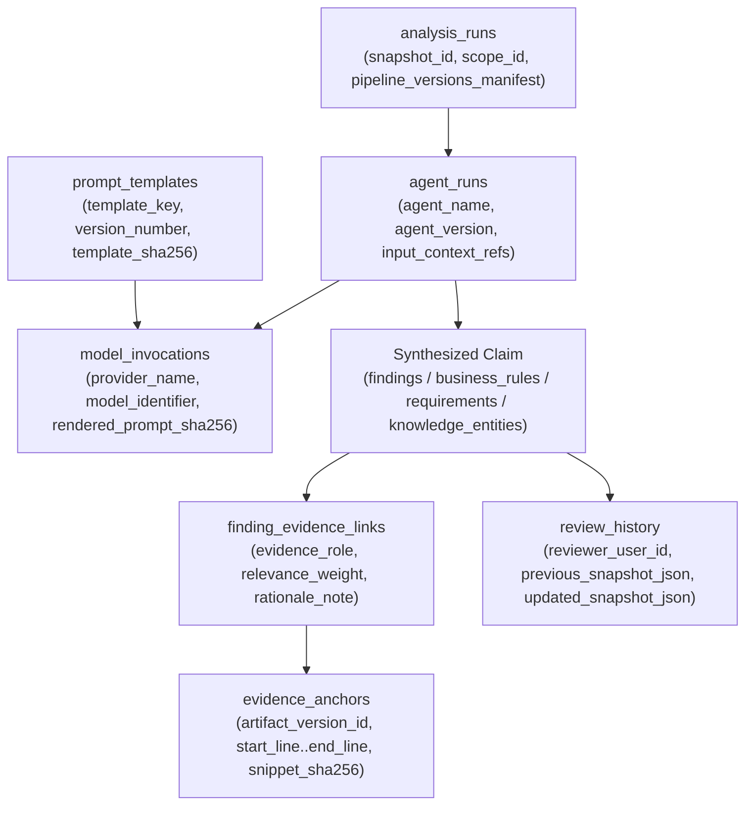

# LegacyIQ — Evidence, Provenance, Confidence & Conflict Model (Design Phase D3)

**Document ID**: `D3-06`  
**Status**: Architecture Specification  

---

## 1. The Zero-Hallucination Evidence Architecture

Every analytical claim in LegacyIQ—whether a discovered business rule, reconstructed requirement, architectural dependency, technical debt item, or modernization recommendation—must answer two questions with cryptographic precision:
1. **Where in the customer's artifacts is the proof?** (*Source Evidence Model*)
2. **Which parser, rule engine, AI model, prompt version, or human architect produced this claim?** (*Provenance & Lineage Model*)

---

## 2. Immutable Source Evidence Model (`evidence_anchors` + `finding_evidence_links`)

### 2.1 Why Evidence Points to `artifact_version_id` (Not Mutable File Paths)
In legacy repositories, files are moved, edited, or deleted across commits. If an evidence record only stored `"file": "billing/pricing.py", "lines": "94-101"`, checking out a newer branch would silently invalidate the line numbers.

LegacyIQ solves this by pinning every `evidence_anchors` row to:
- `artifact_version_id` (`FK -> artifact_versions`), which is keyed by `content_sha256` (`CHAR(64)`).
- `snapshot_id` (`FK -> repository_snapshots`), capturing the repository tree context.
- Exact coordinates (`locator_type`, `start_line`, `end_line`, `start_column`, `end_column`, `ast_or_json_path`).
- `snippet_sha256` (`CHAR(64)`): The SHA-256 hash of the exact substring extracted from `artifact_version_id` at `[start_line:end_line]`.

### 2.2 Supported Evidence Locator Types (`locator_type`)

| `locator_type` | Target Artifact Kinds | Coordinate Fields Used | Example |
| :--- | :--- | :--- | :--- |
| `'LINE_RANGE'` | `SOURCE_FILE`, `DDL_SCRIPT`, `IAC_FILE` | `start_line`, `end_line`, `start_column`, `end_column` | Lines `94`–`101` of `pricing_engine.py` |
| `'AST_NODE_PATH'` | `SOURCE_FILE` | `start_line`, `end_line`, `ast_or_json_path` | `ClassDef:PricingEngine/FunctionDef:apply_discount/If:2` |
| `'JSON_POINTER'` | `OPENAPI_SPEC`, `IAC_FILE` (JSON/YAML) | `start_line`, `end_line`, `ast_or_json_path` | `#/paths/~1api~1v1~1orders/post/responses/200` |
| `'DOC_HEADING'` | `DOC_FILE` | `start_line`, `end_line`, `ast_or_json_path` | `Section[3.2 Institutional Pricing Rules]` |
| `'BYTE_SPAN'` | Large/minified files | `start_column` (start byte), `end_column` (end byte) | Bytes `14200`–`14580` |

### 2.3 Citation Verification Gate (Anti-Hallucination Guardrail)
Before any AI agent output is committed to PostgreSQL (Transaction Boundary T4 in [database-architecture.md](file:///C:/LegacyIQ/docs/database/database-architecture.md)):
1. The worker resolves the cited `(artifact_version_id, start_line, end_line)`.
2. Verifies that `1 <= start_line <= end_line <= artifact_versions.line_count`.
3. Computes `sha256(extracted_slice)` and stores it in `evidence_anchors.snippet_sha256`.
4. If the LLM cited a non-existent file or out-of-bounds line range, the worker logs an `agent_execution_events` entry with `event_type = 'HALLUCINATION_REJECTED'` and rejects or retries the invocation—**never persisting unverified citations**.

---

## 3. Provenance & Execution Lineage Chain

Every synthesized record in Domains F, G, and H carries complete execution lineage across four levels:

### Provenance Origin Taxonomy (`origin_type`)
Every entity, relationship, finding, business rule, and requirement must classify its origin using one of five canonical values:
1. `'DETERMINISTIC_PARSER'`: Direct AST / DDL / OpenAPI grammar output (e.g., Tree-sitter or Python `ast`).
2. `'DETERMINISTIC_RULE'`: Deterministic graph/static rule over AST facts (e.g., Tarjan cycle detector finding a circular module dependency, or regex/AST SQL table extractor).
3. `'HYBRID_AI_STATIC'`: Deterministic AST skeleton (e.g., extracted `if/elif/else` condition tree and call targets) enriched/translated into domain language by an AI agent.
4. `'AI_INFERRED'`: Synthesized by an AI agent across multiple chunks/files (e.g., high-level requirement or modernization strategy).
5. `'HUMAN_AUTHORED'`: Created directly by an authenticated human architect or domain expert.

---

## 4. Confidence Scoring Model (`confidence_score`)

All confidence scores are stored as `NUMERIC(5,4)` constrained to `[0.0000, 1.0000]`:

$$\text{composite\_confidence} = w_{\text{origin}} \cdot C_{\text{origin}} + w_{\text{evidence}} \cdot C_{\text{evidence}} + w_{\text{corroboration}} \cdot C_{\text{corroboration}}$$

| Score Band | UI Badge / Tier | Meaning & Default Governance Rule |
| :---: | :--- | :--- |
| `1.0000` | **Deterministic / Verified** | Exact static parser output (`DETERMINISTIC_PARSER`) or human-approved (`APPROVED`). |
| `0.8500 – 0.9999` | **High Confidence** | Multi-source corroborated finding (e.g., AST control flow + matching unit test + valid `evidence_anchors`). Eligible for batch review. |
| `0.6500 – 0.8499` | **Medium Confidence** | Single-source AI inference with valid code anchor (`HYBRID_AI_STATIC` or `AI_INFERRED`). Requires individual human review before baseline sign-off. |
| `0.4000 – 0.6499` | **Low / Exploratory** | Ambiguous dynamic dispatch, reflection, or partial context. Flagged as `DRAFT_AI` with warning indicator. |
| `< 0.4000` | **Suppressed / Quarantined** | Retained only in diagnostic telemetry; hidden from default requirements/architecture views unless filter is toggled. |

---

## 5. Contradiction & Conflict Resolution Model (`knowledge_conflicts`)

Legacy systems frequently contain contradictions between what the documentation claims, what comments say, and what the executable code actually does. Rather than silently overwriting one with the other, LegacyIQ models contradictions explicitly in `knowledge_conflicts`:

### Conflict Categories (`conflict_type`)
1. `'CODE_VS_DOC'`: Documentation (`doc_sections`) states behavior $X$ (`conflicting_evidence_anchor_id`), whereas executable AST (`code_symbols`) implements behavior $Y$ (`primary_evidence_anchor_id`).
   - *Default Precedence Rule*: Executable code is flagged as primary (`PRIMARY_DEFINITION`), documentation is flagged as `'CONTRADICTING_SOURCE'`, and a `knowledge_conflicts` record is opened (`status = 'OPEN'`).
2. `'STATIC_VS_RUNTIME'`: Static call analysis marks a route/method as unreachable, but `runtime_observations` shows active production invocations (e.g., invoked via dynamic reflection or framework DI).
3. `'AI_RUN_DIVERGENCE'`: A newer `analysis_run_id` infers a materially conflicting requirement or rule compared to a previously `APPROVED` human-reviewed item.
4. `'REQUIREMENT_CONTRADICTION'`: Two extracted business rules in different modules enforce mutually incompatible invariants on the same database table/column.

### Human Review & Immutable Audit Trail (`review_history`)
- When a human architect reviews a finding, business rule, requirement, or conflict:
  1. The target record's `review_status` transitions (e.g., `'PENDING_REVIEW'` → `'APPROVED'` or `'MODIFIED_BY_HUMAN'`) and `version_no` increments (`version_no = version_no + 1`).
  2. Within the same ACID transaction, a row is inserted into `review_history` containing:
     - `previous_snapshot_json`: Exact JSON serialization of the AI's original output.
     - `updated_snapshot_json`: Exact JSON serialization of the human-approved or human-edited state.
     - `reviewer_user_id`, `review_comment`, and `reviewed_at`.
  3. Subsequent AI re-runs check `review_status IN ('APPROVED', 'MODIFIED_BY_HUMAN', 'REJECTED')` and **never overwrite** human-curated records.

