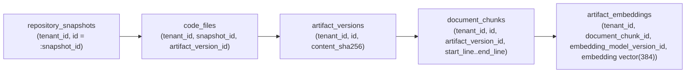

# LegacyIQ — Indexing, Vector Retrieval & Query Strategy (Design Phase D3)

**Document ID**: `D3-08`  
**Status**: Architecture Specification  

---

## 1. Indexing Philosophy for Multi-Tenant Scale

Because every query in LegacyIQ executes under PostgreSQL Row-Level Security (`tenant_id = current_setting('app.current_tenant_id')::uuid`), **every B-tree index on a tenant-owned table places `tenant_id` as the leading column** (except when a single-column `UNIQUE(id)` index is needed by ORM identity lookups). This guarantees that PostgreSQL never scans index pages belonging to other tenants.

---

## 2. Primary B-Tree & Composite Index Catalogue

| Domain | Table | Index Name | Index Columns & Type | Target Access Pattern |
| :---: | :--- | :--- | :--- | :--- |
| **A** | `organization_memberships` | `ux_org_members_tenant_user` | `UNIQUE (tenant_id, user_id)` | Fast tenant membership resolution during JWT/session auth. |
| **B** | `projects` | `ux_projects_workspace_key` | `UNIQUE (tenant_id, workspace_id, key)` | Workspace project lookup. |
| **B** | `applications` | `ux_applications_proj_code` | `UNIQUE (tenant_id, project_id, code)` | Project application lookup. |
| **C** | `repository_snapshots` | `ux_snapshots_repo_num` | `UNIQUE (tenant_id, repository_id, snapshot_number DESC)` | Fetching latest `READY` snapshot for a repository. |
| **C** | `artifact_versions` | `ix_artifact_versions_sha256` | `BTREE (tenant_id, content_sha256)` | O(log N) deduplication check during repository/ZIP ingestion. |
| **D** | `code_files` | `ux_code_files_snap_path` | `UNIQUE (tenant_id, snapshot_id, relative_path)` | File tree navigation and path resolution. |
| **D** | `code_files` | `ix_code_files_artifact_ver` | `BTREE (tenant_id, artifact_version_id)` | Reverse lookup from content-addressed blob to snapshots. |
| **D** | `code_symbols` | `ix_code_symbols_snap_qname` | `BTREE (tenant_id, snapshot_id, qualified_name)` | Cross-file symbol resolution & UI symbol search. |
| **D** | `code_symbols` | `ix_code_symbols_file_lines` | `BTREE (tenant_id, code_file_id, start_line, end_line)` | Mapping line ranges to enclosing AST symbols. |
| **D** | `code_symbols` | `ix_code_symbols_ast_hash` | `BTREE (tenant_id, body_ast_hash)` | Detecting moved/renamed functions across snapshots. |
| **D** | `code_call_edges` | `ix_call_edges_caller` | `BTREE (tenant_id, snapshot_id, caller_symbol_id)` | Outgoing call graph traversal. |
| **D** | `code_call_edges` | `ix_call_edges_callee` | `BTREE (tenant_id, snapshot_id, callee_symbol_id)` | Incoming callers ("Find Usages" / blast radius). |
| **F** | `knowledge_entities` | `ux_ke_run_type_key` | `UNIQUE (tenant_id, application_id, snapshot_id, analysis_run_id, entity_type, canonical_key)` | Idempotent entity upsert during analysis runs. |
| **F** | `knowledge_relationships` | `ix_kr_forward_traverse` | `BTREE (tenant_id, snapshot_id, analysis_run_id, source_entity_id, relationship_type) INCLUDE (target_entity_id, confidence_score, edge_weight)` | Covering index for forward recursive CTE graph traversal (Index-Only Scan). |
| **F** | `knowledge_relationships` | `ix_kr_reverse_traverse` | `BTREE (tenant_id, snapshot_id, analysis_run_id, target_entity_id, relationship_type) INCLUDE (source_entity_id, confidence_score, edge_weight)` | Covering index for backward impact analysis (Index-Only Scan). |
| **F** | `findings` | `ix_findings_app_filter` | `BTREE (tenant_id, application_id, snapshot_id, finding_category, severity, review_status)` | Filtered findings dashboard queries. |
| **F** | `evidence_anchors` | `ix_evidence_artifact_ver` | `BTREE (tenant_id, artifact_version_id, start_line, end_line)` | Verifying and deduplicating source citations. |
| **F** | `finding_evidence_links` | `ix_fel_finding` | `BTREE (tenant_id, finding_id)` | Loading all evidence spans for a finding report. |
| **F** | `finding_evidence_links` | `ix_fel_rule_req` | `BTREE (tenant_id, business_rule_id, requirement_id)` | Loading evidence spans for rules and requirements. |
| **F** | `review_history` | `ix_review_hist_target` | `BTREE (tenant_id, target_object_type, target_object_id, reviewed_at DESC)` | Audit timeline per reviewed item. |
| **G** | `requirements` | `ix_requirements_app_type` | `BTREE (tenant_id, application_id, snapshot_id, req_type, review_status)` | Requirements catalog filtering. |
| **K** | `audit_logs` | `ix_audit_logs_tenant_time` | `BTREE (tenant_id, occurred_at DESC)` | Compliance audit log pagination. |

---

## 3. Specialized GIN Indexes (Full-Text & JSONB)

1. **Hybrid Lexical Search on `document_chunks`**:
   - Pure vector search struggles with exact legacy identifiers (e.g., `ERR_ORD_4092`, `CUST_ACCT_MSTR_TBL`).
   - `document_chunks` includes a generated `tsvector` column `search_tsv` using the `'simple'` dictionary (which preserves underscores and alphanumeric code tokens) indexed via GIN:
     ```sql
     ALTER TABLE document_chunks
       ADD COLUMN search_tsv tsvector
       GENERATED ALWAYS AS (to_tsvector('simple', coalesce(chunk_text, ''))) STORED;

     CREATE INDEX ix_doc_chunks_search_tsv
       ON document_chunks USING GIN (search_tsv);
     ```
2. **Trigram Identifier Search (`pg_trgm`) on `code_symbols`**:
   - Enables fast substring/fuzzy symbol lookup (`ILIKE '%PricingEngine%'`):
     ```sql
     CREATE EXTENSION IF NOT EXISTS pg_trgm;
     CREATE INDEX ix_code_symbols_qname_trgm
       ON code_symbols USING GIN (qualified_name gin_trgm_ops);
     ```
3. **JSONB Attribute Filtering on `knowledge_entities`**:
   - Uses `jsonb_path_ops` for compact, fast containment queries (`attributes_json @> '{"domain": "BILLING"}'`):
     ```sql
     CREATE INDEX ix_ke_attributes_gin
       ON knowledge_entities USING GIN (attributes_json jsonb_path_ops);
     ```

---

## 4. `pgvector` HNSW Indexing & Exact Snapshot Mapping Strategy

### 4.1 How Embeddings Map to Exact Artifact & Snapshot Versions Without Duplication

A key requirement of LegacyIQ is that semantic search must always be scoped to a specific **Snapshot (`snapshot_id`)** and **Tenant (`tenant_id`)**, while avoiding duplicating embeddings across snapshots when files have not changed.

The join topology achieves both **100% snapshot accuracy** and **zero cross-snapshot vector duplication**:



- When Snapshot #2 is ingested and 95% of files have the same `content_sha256` as Snapshot #1:
  - `code_files` for Snapshot #2 simply references the existing `artifact_version_id` rows.
  - Those `artifact_version_id` rows already have `document_chunks` and `artifact_embeddings`.
  - Only the 5% modified/new `artifact_versions` require chunking and embedding generation!

### 4.2 `pgvector` 0.8.7 HNSW Index Configuration
- **Vector Column**: `artifact_embeddings.embedding vector(384)` (aligned with `BAAI/bge-small-en-v1.5` normalized embeddings).
- **Index Definition**:
  ```sql
  CREATE INDEX ix_artifact_embeddings_hnsw_cosine
    ON artifact_embeddings
    USING hnsw (embedding vector_cosine_ops)
    WITH (m = 16, ef_construction = 64);
  ```
- **Iterative Scan for Filtered Multi-Tenant Queries (`pgvector 0.8.0+`)**:
  - In `pgvector` v0.8.7 (verified installed in LegacyIQ's PostgreSQL 17 container), HNSW supports **iterative index scans** (`SET LOCAL hnsw.iterative_scan = relaxed_order; SET LOCAL hnsw.ef_search = 80;`).
  - This prevents "post-filtering starvation" when filtering by `tenant_id` and `snapshot_id` via `code_files`.

### 4.3 Canonical Hybrid Retrieval Query (Vector + Lexical Reciprocal Rank Fusion)

```sql
-- Scoped Hybrid Retrieval (Vector Cosine Similarity + Lexical Token Match) for a Specific Snapshot
WITH snapshot_versions AS (
    SELECT DISTINCT cf.artifact_version_id, cf.relative_path
    FROM code_files cf
    WHERE cf.tenant_id = current_setting('app.current_tenant_id')::uuid
      AND cf.snapshot_id = :snapshot_id
),
vector_candidates AS (
    SELECT
        dc.id AS chunk_id,
        sv.relative_path,
        dc.artifact_version_id,
        dc.start_line,
        dc.end_line,
        dc.chunk_text,
        1 - (ae.embedding <=> :query_vector::vector(384)) AS cosine_similarity,
        ROW_NUMBER() OVER (ORDER BY ae.embedding <=> :query_vector::vector(384)) AS vec_rank
    FROM artifact_embeddings ae
    INNER JOIN document_chunks dc
        ON dc.tenant_id = ae.tenant_id AND dc.id = ae.document_chunk_id
    INNER JOIN snapshot_versions sv
        ON sv.artifact_version_id = dc.artifact_version_id
    WHERE ae.tenant_id = current_setting('app.current_tenant_id')::uuid
      AND ae.embedding_model_version_id = :active_model_version_id
    ORDER BY ae.embedding <=> :query_vector::vector(384)
    LIMIT 50
),
lexical_candidates AS (
    SELECT
        dc.id AS chunk_id,
        sv.relative_path,
        dc.artifact_version_id,
        dc.start_line,
        dc.end_line,
        dc.chunk_text,
        ts_rank_cd(dc.search_tsv, plainto_tsquery('simple', :query_text)) AS lex_score,
        ROW_NUMBER() OVER (
            ORDER BY ts_rank_cd(dc.search_tsv, plainto_tsquery('simple', :query_text)) DESC
        ) AS lex_rank
    FROM document_chunks dc
    INNER JOIN snapshot_versions sv
        ON sv.artifact_version_id = dc.artifact_version_id
    WHERE dc.tenant_id = current_setting('app.current_tenant_id')::uuid
      AND dc.search_tsv @@ plainto_tsquery('simple', :query_text)
    LIMIT 50
)
SELECT
    COALESCE(v.chunk_id, l.chunk_id) AS chunk_id,
    COALESCE(v.relative_path, l.relative_path) AS relative_path,
    COALESCE(v.artifact_version_id, l.artifact_version_id) AS artifact_version_id,
    COALESCE(v.start_line, l.start_line) AS start_line,
    COALESCE(v.end_line, l.end_line) AS end_line,
    COALESCE(v.chunk_text, l.chunk_text) AS chunk_text,
    COALESCE(1.0 / (60 + v.vec_rank), 0.0) + COALESCE(1.0 / (60 + l.lex_rank), 0.0) AS rrf_score
FROM vector_candidates v
FULL OUTER JOIN lexical_candidates l ON v.chunk_id = l.chunk_id
ORDER BY rrf_score DESC
LIMIT 20;
```

