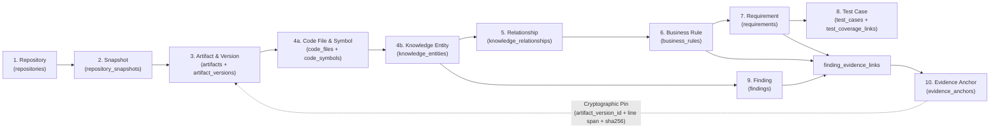

# LegacyIQ — Unified Knowledge Model Specification (Design Phase D3)

**Document ID**: `D3-05`  
**Status**: Architecture Specification  

---

## 1. Architectural Purpose of the Unified Knowledge Model

Legacy modernization teams struggle because technical artifacts (files, classes, SQL tables, endpoints) and business/specification artifacts (business rules, requirements, test cases, modernization recommendations) live in disconnected silos.

LegacyIQ unifies these layers into a **Two-Tier Relational Knowledge Architecture**:
1. **Domain-Specific Structural Tables (Domains C, D, E, G, H)**: Preserve strongly-typed, domain-specific schemas with strict relational integrity (e.g., `code_symbols` has `start_line`, `cyclomatic_complexity`, `body_ast_hash`; `business_rules` has `condition_expression`, `action_consequence`; `requirements` has `req_type`, `priority`).
2. **Unified Knowledge Graph & Evidence Spine (Domain F)**: Bridges all domains through `knowledge_entities`, `knowledge_relationships`, `findings`, `evidence_anchors`, and `finding_evidence_links`.

---

## 2. End-to-End Traceability Chain

Below is the canonical traversal path connecting a raw ingested repository to an evidence-backed requirement, test case, and architectural finding:

---

## 3. Concrete Walkthrough Example: Institutional Order Discount & Tax Rule

Consider a legacy Python/PostgreSQL order-processing monolith (`acme-order-monolith`) owned by tenant `org_acme` (`tenant_id = '0192e8a0-0000-7000-8000-000000000001'`).

### Step 1: Repository (`repositories`) — *Deterministic Fact*
- **Record**: `repositories.id = '0192e8a1-...-0010'`
- **Attributes**:
  - `name = 'acme-order-monolith'`
  - `source_type = 'GIT'`
  - `default_branch = 'main'`

### Step 2: Immutable Snapshot (`repository_snapshots`) — *Deterministic Fact*
- **Record**: `repository_snapshots.id = '0192e8a2-...-0020'`
- **Attributes**:
  - `repository_id = '0192e8a1-...-0010'`
  - `snapshot_number = 1`
  - `tree_or_archive_sha256 = '9f86d081884c7d659a2feaa0c55ad015a3bf4f1b2b0b822cd15d6c15b0f00a08'`
  - `status = 'READY'`

### Step 3: Logical Artifact & Immutable Version (`artifacts` → `artifact_versions`) — *Deterministic Fact*
- **Logical Artifact (`artifacts`)**:
  - `id = '0192e8a3-...-0030'`
  - `artifact_kind = 'SOURCE_FILE'`
  - `canonical_path = 'billing/pricing_engine.py'`
- **Content-Addressed Version (`artifact_versions`)**:
  - `id = '0192e8a3-...-0031'`
  - `artifact_id = '0192e8a3-...-0030'`
  - `content_sha256 = '4b227777d4dd1fc61c6f884f48641d02b4d121d3fd328cb08b5531fcacdabf8a'`
  - `byte_size = 6420`, `line_count = 184`
  - `storage_object_uri = 's3://legacyiq-vault/0192e8a0.../blobs/4b227777...'`

### Step 4: Code Entity (`code_files` → `code_symbols` → `knowledge_entities`) — *Deterministic Fact Bridged to Graph*
- **Snapshot File (`code_files`)**:
  - `id = '0192e8a4-...-0040'`, `snapshot_id = '0192e8a2-...-0020'`, `artifact_version_id = '0192e8a3-...-0031'`, `relative_path = 'billing/pricing_engine.py'`
- **AST Symbol (`code_symbols`)**:
  - `id = '0192e8a4-...-0045'`
  - `symbol_kind = 'METHOD'`
  - `qualified_name = 'billing.pricing_engine.PricingEngine.apply_institutional_tier_discount'`
  - `start_line = 72`, `end_line = 114`
  - `cyclomatic_complexity = 9`
  - `body_ast_hash = 'e3b0c44298fc1c149afbf4c8996fb92427ae41e4649b934ca495991b7852b855'`
- **Unified Graph Node (`knowledge_entities`)**:
  - `id = '0192e8a5-...-0050'`
  - `entity_type = 'SYMBOL'`
  - `source_symbol_id = '0192e8a4-...-0045'`
  - `canonical_key = 'sym:python:billing.pricing_engine.PricingEngine.apply_institutional_tier_discount'`
  - `origin_type = 'DETERMINISTIC_PARSER'`
  - `confidence_score = 1.0000`
  - `review_status = 'DETERMINISTIC_FACT'`

### Step 5: Graph Relationship (`knowledge_relationships`) — *Deterministic + Hybrid Graph Edges*
1. **Static Call Edge**:
   - `source_entity_id = '0192e8a5-...-0050'` (`apply_institutional_tier_discount`)
   - `target_entity_id = '0192e8a5-...-0052'` (`db_table: public.customer_credit_limits`)
   - `relationship_type = 'READS_TABLE'`
   - `origin_type = 'DETERMINISTIC_RULE'` (extracted from SQL AST inside method)
   - `confidence_score = 0.9800`
2. **Rule Implementation Edge**:
   - `source_entity_id = '0192e8a5-...-0050'` (`apply_institutional_tier_discount`)
   - `target_entity_id = '0192e8a5-...-0060'` (Knowledge Entity for Business Rule `BR-PRICE-0014`)
   - `relationship_type = 'IMPLEMENTS_RULE'`
   - `origin_type = 'HYBRID_AI_STATIC'`
   - `confidence_score = 0.9200`

### Step 6: Business Rule (`business_rules`) — *AI Interpretation Grounded in AST*
- **Record**: `business_rules.id = '0192e8a6-...-0061'`
- **Attributes**:
  - `rule_code = 'BR-PRICE-0014'`
  - `rule_category = 'CALCULATION'`
  - `title = 'Institutional Tier Volume Discount & Credit Hold Override'`
  - `condition_expression = 'order_subtotal >= 25000.00 AND customer.account_type == "INSTITUTIONAL" AND customer.credit_hold_flag IS FALSE'`
  - `action_consequence = 'Apply 12.5% volume discount; if order_subtotal >= 100000.00, cap discount at $10,000 unless executive_override_token is present.'`
  - `origin_type = 'HYBRID_AI_STATIC'` (AST condition branches extracted deterministically; domain semantics synthesized by `rule_extractor` agent using `qwen2.5-coder:3b`)
  - `confidence_score = 0.9200`
  - `review_status = 'APPROVED'` (verified by Lead Architect in `review_history`)

### Step 7: Requirement (`requirements` + `requirement_acceptance_criteria` + `requirement_traceability_links`) — *Synthesized Specification*
- **Requirement (`requirements`)**:
  - `id = '0192e8a7-...-0070'`
  - `req_code = 'REQ-FUNC-0031'`
  - `req_type = 'FUNCTIONAL'`
  - `priority = 'MUST'`
  - `title = 'Institutional Volume Discount Calculation and Maximum Cap'`
  - `specification_statement = 'The billing subsystem shall apply a 12.5% discount to institutional orders >= $25,000 when the account is not on credit hold, subject to a hard $10,000 discount ceiling unless an executive override token is supplied.'`
  - `origin_type = 'AI_INFERRED'`
  - `confidence_score = 0.8950`
  - `review_status = 'APPROVED'`
- **Traceability Link (`requirement_traceability_links`)**:
  - Links `requirement_id = '0192e8a7-...-0070'` → `business_rule_id = '0192e8a6-...-0061'` (`link_type = 'DERIVED_FROM_RULE'`) and `code_symbol_id = '0192e8a4-...-0045'` (`link_type = 'IMPLEMENTED_BY_CODE'`).

### Step 8: Test Case (`test_cases` + `test_coverage_links`) — *Characterization Test Blueprint*
- **Test Case (`test_cases`)**:
  - `id = '0192e8a8-...-0080'`
  - `test_key = 'test_institutional_discount_10k_cap_without_override'`
  - `test_kind = 'CHARACTERIZATION'`
  - `last_observed_status = 'NOT_EXECUTED_BLUEPRINT'` (LegacyIQ never executes customer/generated code)
- **Coverage Link (`test_coverage_links`)**:
  - Links `test_case_id = '0192e8a8-...-0080'` to `target_symbol_id = '0192e8a4-...-0045'`, `target_business_rule_id = '0192e8a6-...-0061'`, and `target_requirement_id = '0192e8a7-...-0070'`.

### Step 9: Finding (`findings`) — *Analytical Discovery*
- **Record**: `findings.id = '0192e8a9-...-0090'`
- **Attributes**:
  - `finding_category = 'BUSINESS_RULE'`
  - `severity = 'HIGH'`
  - `title = 'Undocumented $10,000 Institutional Discount Ceiling Hardcoded in PricingEngine'`
  - `statement_markdown = 'While legacy user documentation states institutional orders receive an uncapped 12.5% discount, PricingEngine.apply_institutional_tier_discount enforces a hardcoded $10,000 ceiling at lines 94–101.'`
  - `subject_entity_id = '0192e8a5-...-0050'`
  - `producing_agent_run_id = '0192e8aa-...-0100'`
  - `origin_type = 'HYBRID_AI_STATIC'`
  - `confidence_score = 0.9450`

### Step 10: Evidence Anchor & Link (`evidence_anchors` + `finding_evidence_links`) — *Cryptographic Ground Truth*
- **Primary Code Evidence Anchor (`evidence_anchors`)**:
  - `id = '0192e8ab-...-0110'`
  - `artifact_version_id = '0192e8a3-...-0031'` (`billing/pricing_engine.py` @ SHA `4b227777...`)
  - `snapshot_id = '0192e8a2-...-0020'`
  - `locator_type = 'LINE_RANGE'`
  - `start_line = 94`, `end_line = 101`, `start_column = 8`, `end_column = 52`
  - `snippet_sha256 = '7d865e959b2466918c9863afca942d0fb89d7c9ac0c99bafc3749504ded97730'`
  - `excerpt_text = 'if discount_amount > Decimal("10000.00") and not ctx.executive_override_token:\n    discount_amount = Decimal("10000.00")'`
- **Evidence Link (`finding_evidence_links`)**:
  - Links `evidence_anchor_id = '0192e8ab-...-0110'` simultaneously to:
    - `finding_id = '0192e8a9-...-0090'` (`evidence_role = 'PRIMARY_DEFINITION'`)
    - `business_rule_id = '0192e8a6-...-0061'` (`evidence_role = 'PRIMARY_DEFINITION'`)
    - `requirement_id = '0192e8a7-...-0070'` (`evidence_role = 'PRIMARY_DEFINITION'`)

---

## 4. Comparison: Deterministic Source Evidence vs. Interpretation

| Dimension | Deterministic Source Evidence (Stratum 1) | Synthesized Knowledge & Interpretation (Stratum 2) |
| :--- | :--- | :--- |
| **Authoritative Tables** | `repository_snapshots`, `artifact_versions`, `code_files`, `code_symbols`, `code_imports`, `code_call_edges` (`EXACT_STATIC`), `evidence_anchors` | `business_rules`, `requirements`, `findings`, `modernization_recommendations`, AI-inferred `knowledge_entities` & `knowledge_relationships` |
| **Mutability** | **Strictly Immutable** once extracted for a `(snapshot_id, parser_version)`. | **Versioned & Reviewable** (`version_no`, `review_status`, `review_history`). |
| **Truth Status** | Verifiable syntactic/structural fact of the artifact at `content_sha256`. | Hypothesis or curated engineering specification backed by `evidence_anchors`. |
| **Can Human Edit In-Place?** | **No.** Humans cannot edit AST line numbers or file SHA-256 hashes. | **Yes, via audited workflow.** Human edits transition `review_status` to `'MODIFIED_BY_HUMAN'` and write before/after JSON snapshots to `review_history`. |
| **Behavior on Re-Analysis** | Identical `artifact_version_id` + parser version yields identical rows (idempotent). | New `analysis_run_id` produces new candidate rows or supersedes prior `DRAFT_AI` rows while never overwriting `APPROVED` or `MODIFIED_BY_HUMAN` records without explicit conflict resolution. |

