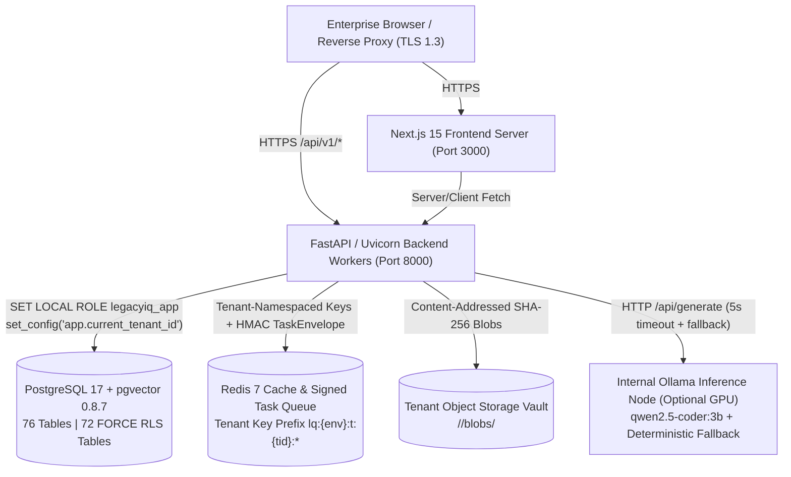

# LegacyIQ — Wave 7 Deployment Guide

**Phase:** Wave 7 — Production Hardening & Deployment Readiness (Phase F & Phase G)  
**Date:** 2026-11-01  
**Status:** Deployment Architecture & Templates Prepared (Public Deployment Requires User Approval & Infrastructure Credentials)

---

## 1. Production Deployment Architecture

LegacyIQ is architected as a **shared multi-tenant enterprise SaaS platform** with strict defence-in-depth tenant isolation:



### 1.1 Component Hosting Evaluation & Recommendations

| Component | Recommended Self-Hosted / VM / Kubernetes Option | Managed Cloud Alternative (No Code Changes) | Multi-Tenant & Persistence Guarantees |
| :--- | :--- | :--- | :--- |
| **Next.js 15 Frontend (`frontend/`)** | Node.js 22 LTS container/process (`npm run build && npm run start`) behind NGINX/Caddy TLS proxy | AWS ECS/App Runner, Azure Container Apps, Google Cloud Run, or Vercel | Stateless UI; uses `NEXT_PUBLIC_API_BASE_URL` and sends security headers (`X-Frame-Options: DENY`, `X-Content-Type-Options: nosniff`). |
| **FastAPI Backend (`backend/`)** | Uvicorn with multiple worker processes (`uvicorn app.main:app --host 0.0.0.0 --port 8000 --workers 4 --proxy-headers`) | AWS ECS/EKS, Google Cloud Run, Azure Container Apps, or systemd service on Linux VM | Enforces `assert_production_ready()` at startup, `TrustedHostMiddleware`, explicit CORS, JWT/RBAC, and `SET LOCAL ROLE legacyiq_app` on every DB session. |
| **PostgreSQL 17 + `pgvector 0.8.7`** | `pgvector/pgvector:pg17` on dedicated Linux volume with daily `pg_dump -Fc` + WAL archiving | AWS RDS for PostgreSQL 17 (`vector` extension enabled), Cloud SQL for PostgreSQL, or Azure Database for PostgreSQL | `76` tables; `72` tables enforce `FORCE ROW LEVEL SECURITY` via `tenant_isolation_policy`. |
| **Redis 7** | `redis:7-alpine` with `requirepass` and AOF persistence (`appendonly yes`) | AWS ElastiCache for Redis, Upstash, or Google Cloud Memorystore | Every cache key is prefixed with `lq:{APP_ENV}:t:{tenant_id}:p:{project_id}:*`; task payloads are signed with `APP_SECRET_KEY` via HMAC-SHA256. |
| **Object / File Storage Vault** | Dedicated encrypted filesystem mount (`STORAGE_VAULT_ROOT=/var/lib/legacyiq/storage_vault`) or shared POSIX NFS/EFS volume | AWS EFS / Azure Files mounted at `STORAGE_VAULT_ROOT` | Strictly partitioned per tenant (`<vault_root>/<tenant_id>/blobs/<sha256[:2]>/<sha256>`). |
| **Local AI Inference (`Ollama`)** | Internal GPU or high-core CPU host running Ollama (`qwen2.5-coder:3b`) on private VPC (`OLLAMA_BASE_URL`) | Self-hosted vLLM/Ollama on GPU VM, or deterministic fallback mode (zero paid API required) | **Zero Paid API Dependency**: If `OLLAMA_BASE_URL` is unreachable or disabled in production, LegacyIQ automatically uses its deterministic AST/DDL/evidence synthesis engine and local CPU embeddings (`BAAI/bge-small-en-v1.5`). |

---

## 2. Mandatory Production Environment Variables Reference

Never commit production secrets to version control. Configure the following environment variables in your deployment secret manager or `/etc/legacyiq/backend.env` (mode `0600`):

| Variable | Required in Prod | Production Requirement / Validation Rule | Purpose |
| :--- | :---: | :--- | :--- |
| `APP_NAME` | Yes | `"LegacyIQ"` | Application identifier used in logs and telemetry. |
| `APP_ENV` | **Yes** | Must be `"production"` | Activates fail-fast startup validation (`assert_production_ready()`) and disables `/docs`, `/redoc`, and `/openapi.json`. |
| `APP_DEBUG` | **Yes** | Must be `false` | Startup fails if `APP_DEBUG=true` when `APP_ENV=production`. |
| `LOG_FORMAT` | Yes | `"json"` (recommended for production) or `"text"` | Emits structured JSON log lines with `correlation_id` and automatic secret/token redaction. |
| `LOG_LEVEL` | Yes | `"INFO"` or `"WARNING"` | Controls root logger verbosity. |
| `APP_SECRET_KEY` | **Yes** | Unique high-entropy string `>= 32` characters (must not be dev default or contain `REPLACE_WITH_PASSWORD`) | Signs HS256 JWT access tokens and HMAC-SHA256 `TaskEnvelope` payloads. Generate via `python -c "import secrets; print(secrets.token_urlsafe(48))"`. |
| `AUTH_TOKEN_EXPIRE_MINUTES` | Yes | `60` (default) | Lifetime in minutes for issued JWT access tokens (`exp` claim). |
| `AUTH_ENFORCE_BEARER_TOKEN` | Yes | `true` (recommended for production) or `false` | When `true`, rejects requests lacking `Authorization: Bearer <jwt>`. |
| `DATABASE_URL` | **Yes** | `postgresql+psycopg://<user>:<password>@<host>:5432/legacyiq` (must not contain `REPLACE_WITH_PASSWORD`) | PostgreSQL 17 + `pgvector` connection URI. |
| `DB_POOL_SIZE` | Yes | `10` (recommended per worker) | SQLAlchemy steady-state connection pool size. |
| `DB_MAX_OVERFLOW` | Yes | `20` (recommended per worker) | Maximum burst connections above `DB_POOL_SIZE`. |
| `DB_POOL_TIMEOUT_SECONDS` | Yes | `30` | Seconds to wait for an available pooled connection before raising timeout. |
| `DB_POOL_RECYCLE_SECONDS` | Yes | `1800` | Recycles connections every 30 minutes to prevent stale NAT/firewall drops. |
| `DB_CONNECT_TIMEOUT_SECONDS` | Yes | `5` | TCP connection timeout to PostgreSQL. |
| `DB_STATEMENT_TIMEOUT_MS` | Yes | `30000` (`30s`) | Per-statement execution timeout enforced via PostgreSQL `statement_timeout`. |
| `REDIS_URL` | **Yes** | `redis://:<password>@<host>:6379/0` (must not contain `REPLACE_WITH_PASSWORD`) | Authenticated Redis connection URI. |
| `REDIS_CONNECT_TIMEOUT_SECONDS` | Yes | `3.0` | Socket connect/read timeout for Redis operations. |
| `STORAGE_VAULT_ROOT` | Yes | Absolute path on persistent volume (e.g. `/var/lib/legacyiq/storage_vault`) | Root directory for tenant-isolated content-addressed blobs and report exports. |
| `BACKEND_CORS_ORIGINS` | **Yes** | Explicit JSON list of HTTPS origins, e.g. `["https://legacyiq.example.com"]` (`*` is rejected in production) | Restricts cross-origin browser requests to authorized frontend domains. |
| `ALLOWED_HOSTS` | **Yes** | Explicit JSON list of hostnames, e.g. `["api.legacyiq.example.com","localhost"]` (`*` is rejected in production) | Enforced by `TrustedHostMiddleware` to prevent HTTP Host header poisoning. |
| `RATE_LIMIT_ENABLED` | Yes | `true` | Enables sliding-window rate limiting middleware (`429 Too Many Requests`). |
| `RATE_LIMIT_DEFAULT_PER_MINUTE` | Yes | `120` | Per-tenant/IP request limit per minute for standard endpoints. |
| `RATE_LIMIT_EXPENSIVE_PER_MINUTE` | Yes | `20` | Per-tenant/IP request limit per minute for `/upload-zip`, `/analyze*`, `/qa/*`, `/reports/generate`, and `/exports`. |
| `OLLAMA_BASE_URL` | Optional | `http://<internal-ollama-host>:11434` | Internal URL for Ollama inference. If unreachable, deterministic fallback is used automatically. |
| `OLLAMA_MODEL` | Optional | `qwen2.5-coder:3b` | Model tag queried by `TechnicalIntelligenceOrchestrator` and `ReportingQaExportService`. |
| `NEXT_PUBLIC_API_BASE_URL` | **Yes (Frontend)** | `https://api.legacyiq.example.com` | Public URL of the FastAPI backend consumed by the Next.js frontend. Contains no secrets. |

---

## 3. Capacity Planning & Resource Readiness (Phase G)

### 3.1 Measured Baseline vs. Production Sizing Estimates

- **Measured Single-Repository Ingestion & Waves 1–5 Latencies** (from [`wave6-performance-report.md`](file:///C:/LegacyIQ/docs/implementation/wave6-performance-report.md)):
  - Full polyglot ZIP ingestion + Waves 1–4 analysis: **`1,355.16 ms`**
  - Hybrid RRF search (`pgvector` HNSW + FTS GIN): **`28.09 ms`**
  - Knowledge graph multi-hop traversal: **`17.79 ms`**
  - Complete 9-section report generation: **`1,317.06 ms`**
  - Binary export generation (`PDF`, `DOCX`, `XLSX`, `JSON`): **`40.32 ms – 46.28 ms`**
- **Enforced Archive & Upload Guards** ([`ingestion_service.py`](file:///C:/LegacyIQ/backend/app/services/ingestion_service.py)):
  - Max compressed archive size: **`50 MB`** (`MAX_ARCHIVE_COMPRESSED_BYTES`)
  - Max uncompressed archive size: **`150 MB`** (`MAX_ARCHIVE_UNCOMPRESSED_BYTES`)
  - Max single file size: **`10 MB`** (`MAX_SINGLE_FILE_BYTES`)
  - Max files per archive: **`2,500`** (`MAX_ARCHIVE_FILE_COUNT`)
  - Max compression ratio: **`100:1`** (`MAX_COMPRESSION_RATIO`)

### 3.2 Minimum & Recommended Hardware Specifications (Estimated)

| Tier | Workload Profile (Estimated) | FastAPI Backend | PostgreSQL 17 + `pgvector` | Redis 7 | Ollama Inference Node (Optional) | Storage Vault (`STORAGE_VAULT_ROOT`) |
| :--- | :--- | :--- | :--- | :--- | :--- | :--- |
| **Minimum Production** | Up to `5` concurrent users, repositories up to `20 MB` ZIP | `2 vCPU`, `4 GB RAM` (`2` Uvicorn workers, `DB_POOL_SIZE=5`, `DB_MAX_OVERFLOW=10`) | `2 vCPU`, `4 GB RAM`, `50 GB SSD` (`max_connections=100`) | `1 vCPU`, `1 GB RAM` (`maxmemory 512mb`, `allkeys-lru`) | `4 vCPU`, `8 GB RAM` (CPU inference for `qwen2.5-coder:3b` requires ~2.5 GB RAM) or disabled (deterministic fallback) | `50 GB SSD` |
| **Recommended Enterprise Production** | `20–50` concurrent users, repositories up to `50 MB` ZIP (`2,500` files) | `4–8 vCPU`, `16 GB RAM` (`4` Uvicorn workers, `DB_POOL_SIZE=10`, `DB_MAX_OVERFLOW=20`) | `4 vCPU`, `16 GB RAM`, `250 GB NVMe SSD` (`max_connections=250`, HNSW index fits in `shared_buffers=4GB`) | `2 vCPU`, `4 GB RAM` (`maxmemory 2gb`, AOF persistence) | `1x NVIDIA L4 / T4 GPU` (`16–24 GB VRAM`) or `8 vCPU / 16 GB RAM` | `500 GB NVMe SSD` (allowing ~`2,500` snapshots at ~`200 MB` average blob/export footprint) |

---

## 4. Step-by-Step Production Deployment Procedure

1. **Provision Infrastructure**:
   - Ensure PostgreSQL 17 with `pgvector >= 0.8.0` and Redis 7 are reachable over a private network with TLS and strong passwords.
   - Create persistent storage directory `/var/lib/legacyiq/storage_vault` owned by the `legacyiq` service user (`chmod 0750`).
2. **Configure Production Environment**:
   - Populate `/etc/legacyiq/backend.env` from [`backend/.env.example`](file:///C:/LegacyIQ/backend/.env.example) with `APP_ENV=production`, `APP_DEBUG=false`, `LOG_FORMAT=json`, a 48-byte `APP_SECRET_KEY`, explicit `BACKEND_CORS_ORIGINS`, and explicit `ALLOWED_HOSTS`.
3. **Run Forward-Only Alembic Database Migrations**:
   ```bash
   alembic -c backend/alembic.ini upgrade head
   alembic -c backend/alembic.ini current
   # Expected output: 0007_wave5_qa_reports_export (head)
   ```
4. **Start FastAPI Backend**:
   ```bash
   uvicorn app.main:app --app-dir backend --host 0.0.0.0 --port 8000 --workers 4 --proxy-headers --timeout-keep-alive 30
   ```
5. **Verify Composite Readiness Probe**:
   ```bash
   curl -fsS http://127.0.0.1:8000/api/v1/health/readiness
   # Expected HTTP 200 with "status": "ready"
   ```
6. **Build & Start Next.js Production Frontend**:
   ```bash
   npm --prefix frontend ci
   NEXT_PUBLIC_API_BASE_URL=https://api.legacyiq.example.com npm --prefix frontend run build
   PORT=3000 npm --prefix frontend run start
   ```

